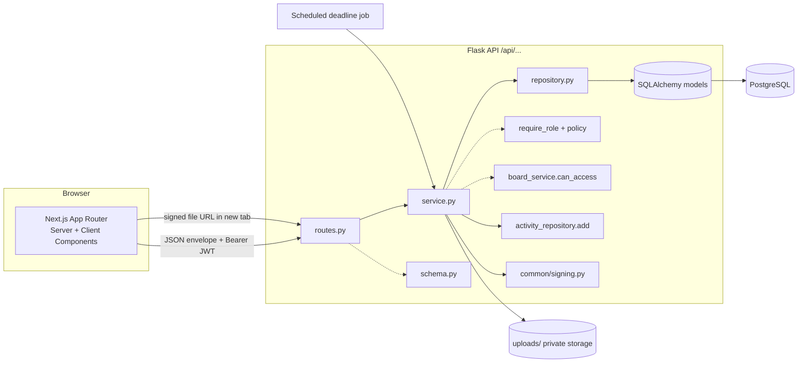
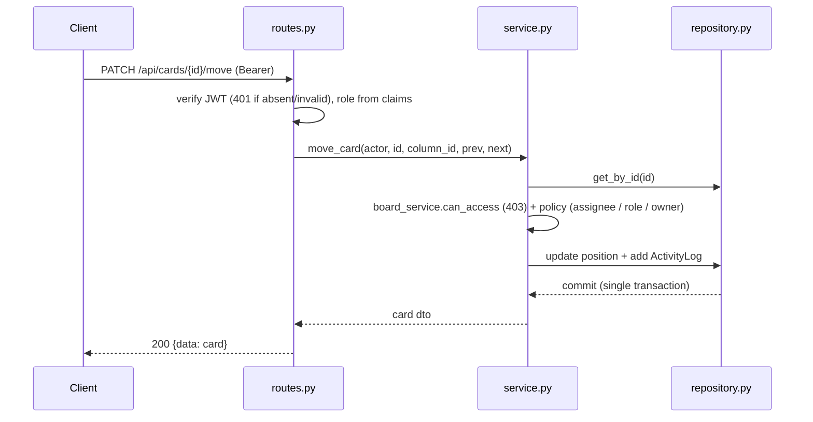
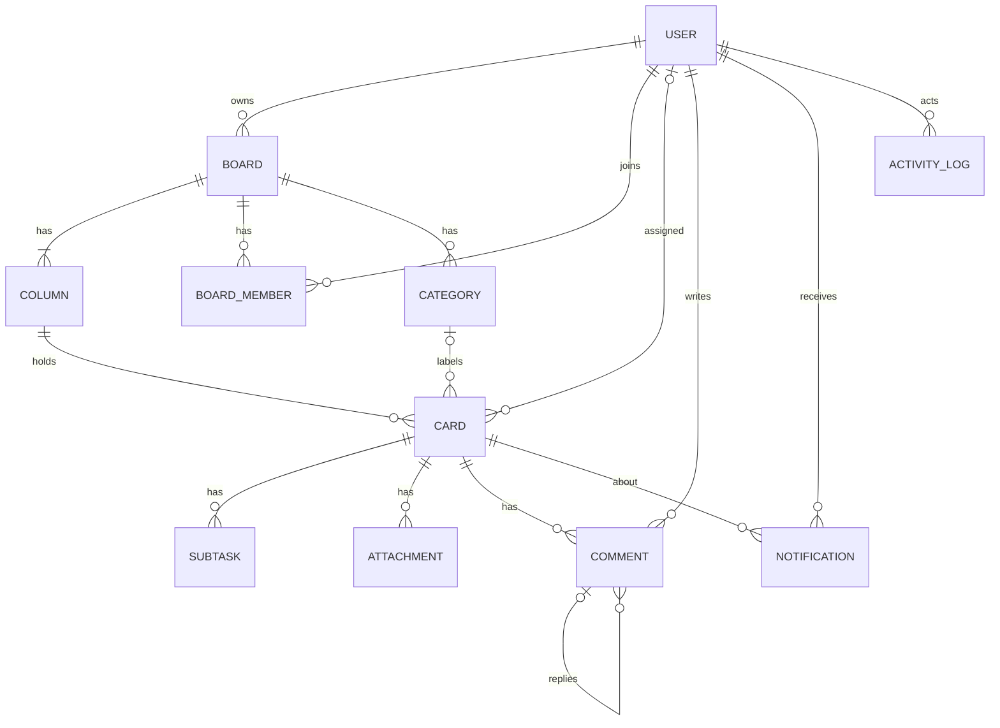

# Design Document

## Overview

This document is the technical design for the Kanban Task Management application (Version V2). It implements the V2 `requirements.md` using the stack and conventions fixed in the workspace steering (already updated to V2): a Flask + SQLAlchemy REST API organized as one blueprint per domain, and a mobile-first Next.js (App Router, TypeScript) frontend. Requirement references use the V2 criterion numbers. "Decision A" to "Decision D" refer to the Decisions Log in `requirements.md`.

Key design decisions:

| Decision | Choice | Rationale |
|---|---|---|
| Backend layering | `routes.py → service.py → repository.py → model`, plus `schema.py` | Services are unit-testable against a fake repository (Req 15.4, 13.7). |
| Board access | `board_service.can_access(user, board)` (Board_Access) gates every board-scoped read and comment; `board_service.can_write_staff(user, board)` (Board_Staff_Access) gates Supervisor, Manager, and Admin writes (Decision A) | "Private" must gate unrelated signed-in users and cannot drift per endpoint (Req 11.6, 11.11, 12.7); an unrelated Supervisor must not write on a public Board (Req 3.4, 4.1, 6.1). |
| Authorization | `require_role(...)` decorator for the role gate, plus service-level policy functions that combine role, `can_access`, `can_write_staff`, and assignment | Role comes only from the Token (Req 2.7). Ownership and assignment rules need data, so they live in services. |
| Role model | Numeric rank for guest < member < supervisor < manager; admin is a separate capability set | Additive hierarchy without duplicated rules (Req 2.2, 2.3). Admin is deliberately not a Manager superset (Decision B). |
| Status codes | No Token returns 401; valid Token with insufficient role or access returns 403, everywhere. A Guest requesting a private Board gets 401 | Req 2.8, 2.9, 11.5, 12.7, 13.10. |
| Auth transport | Stateless JWT bearer token, fixed 24-hour expiry, no revocation list; passwords hashed with argon2 (`argon2-cffi`) | Req 1.13, 1.14, 1.16. Rate limiting is deferred (Req 1.18). |
| Login identity | One `login_identifier` column, unique case-insensitively through a functional unique index on `lower(login_identifier)` | Decision C, Req 1.1 to 1.5. |
| Ordering | `Float` `order`; first = `min - 1`, last = `max + 1`, empty = `1.0`, otherwise average; renumber the whole sibling list when the gap falls below `1e-6` | Req 4.13, 5.1, 5.10, 5.11. |
| Deletion | `deleted_at` / `archived_at` on Board and Card only; child rows are hidden through a join on the parent Card's `deleted_at` | Req 3.8, 4.23, 4.29. |
| Audit | `ActivityLog` row written by the service in the same transaction as the change | Req 8.1. |
| Guest privacy | Serializers omit `comments`, `activity`, `activity_log` for guests; comment and activity endpoints reject guests | Absence of the field is the access control (Req 7.16, 8.5, 14.3). |
| Attachment files | Signed, 15-minute file URLs (HMAC over attachment id and expiry); no permanent public URL (Decision D) | Req 4.18, 4.24 to 4.27. This replaces the V1 design, which returned a stable public `file_url`. |
| Deadline job | Scheduled job (APScheduler, or a platform cron calling `flask notify-deadlines`); "today" is computed in `APP_TIMEZONE` | Req 9.2. |
| Frontend rendering | Server Components by default; Client Components only for the board (drag-and-drop), card modal, comment composer, sort toggle, search input, side panel | Req 14.11. |

### Research summary

- Flask blueprints, application factory, and `flask-cors` with an explicit origin list match the steering. See the [Flask blueprint docs](https://flask.palletsprojects.com/en/latest/blueprints/).
- `flask-jwt-extended` provides `create_access_token(expires_delta=timedelta(hours=24))` and `get_jwt()`. Claims (user id, role) are signed, so the role cannot be forged from a request body. See the [Flask-JWT-Extended docs](https://flask-jwt-extended.readthedocs.io/).
- Case-insensitive uniqueness in PostgreSQL is done with a functional unique index on `lower(column)`. Lookups use `func.lower(...)` so the index is used.
- Signed expiring URLs: an HMAC-SHA256 over `"{attachment_id}.{exp}"` with a server secret, compared with `hmac.compare_digest`, gives a stateless token that a plain browser tab can present. `itsdangerous` offers an equivalent timed serializer; the explicit HMAC is chosen because the clock can be injected in tests.
- Fractional (Float) ordering is the usual cheap reorder technique. Repeated averaging exhausts float precision after roughly 50 consecutive inserts in the same gap, so the service renumbers the sibling list when the gap falls below `1e-6`.
- Property-based testing: `hypothesis` for Python services, `fast-check` for TypeScript pure helpers.

Content from these sources was summarized, not quoted.

## Architecture



### Backend layout

```
backend/app/
  __init__.py            # create_app(): config, CORS, db, blueprints, error handlers, CLI
  extensions.py          # db, migrate
  common/
    auth.py              # require_role, current_user, role rank, Actor
    errors.py            # AppError subclasses + envelope error handler
    responses.py         # ok(data, status=200)
    ordering.py          # between(a, b), position_for(...), needs_rebalance, rebalance
    signing.py           # sign_file_url(attachment_id, now), verify_file_signature(...)
    clock.py             # today(tz), now(): injectable for tests
  models/                # one module per entity, UUID PKs, TimestampMixin
  blueprints/
    auth/ boards/ columns/ cards/ categories/ comments/
    notifications/ analytics/ users/     # each: routes.py service.py repository.py schema.py
  jobs/deadlines.py      # daily deadline notifications
  docs.py                # register_docs(app): Swagger UI + openapi.yaml, only when APP_ENV is not production
backend/tests/           # pytest + hypothesis, fake repositories
backend/openapi.yaml     # OpenAPI 3 source of truth for the API reference
backend/API.md           # human-readable reference, same endpoints as openapi.yaml
```

Activity has no public blueprint of its own. Activity reads are exposed through the `cards` blueprint (`GET /api/cards/{id}/activity`) and the `boards` blueprint (`GET /api/boards/{id}/activity`). Writes go through `activity_repository.add(...)`, called by each service inside its own transaction. Board members are handled inside the `boards` blueprint (`board_service`, `board_repository`); attachments are a sub-resource of `cards`.

### Environment variables (listed in each app's `.env.example`, never a real `.env`)

Backend: `DATABASE_URL`, `JWT_SECRET`, `ALLOWED_ORIGINS`, `FILE_URL_SECRET` (HMAC key for signed file URLs, separate from `JWT_SECRET`), `APP_TIMEZONE` (IANA name, for example `UTC`), `UPLOAD_DIR`, `APP_ENV` (`development`, `testing`, or `production`; optional, defaults to `production`; controls API documentation routes, see Requirement 17). Frontend: `NEXT_PUBLIC_API_URL`. The app refuses to start when `ALLOWED_ORIGINS`, `JWT_SECRET`, `FILE_URL_SECRET`, or `APP_TIMEZONE` is missing, or when `ALLOWED_ORIGINS` contains `*`.

### Frontend layout

```
frontend/
  app/
    (auth)/login/page.tsx, register/page.tsx
    (app)/layout.tsx                 # Sidebar + Main shell, side panel host
    (app)/boards/[id]/page.tsx       # Server Component, fetches board
    (app)/boards/[id]/categories/page.tsx
    (app)/boards/[id]/members/page.tsx   # owner, Manager, Admin
    (app)/admin/users/page.tsx
  components/shared/                 # BaseButton, BaseBadge, BaseModal
  components/                        # Sidebar, Board (client), CardModal (client), ...
  lib/api.ts                         # single envelope unwrap/throw
  lib/ordering.ts                    # pure drop-order computation
  styles/tokens.css                  # prototype :root custom properties
```

### Request flow for a mutating call



## Components and Interfaces

### Cross-cutting backend components

- **`common/auth.py`**
  - `ROLE_RANK = {"guest": 0, "member": 1, "supervisor": 2, "manager": 3}`; `admin` is outside the ladder.
  - `require_role(*roles)`: reads the JWT claims, returns 401 when absent or invalid, 403 when the role is not listed. Never reads `role` from the request body.
  - `Actor` dataclass `(id, role)`; a Guest is `None`. Services never touch Flask globals.
- **`common/errors.py`**: `ValidationError` (400, `VALIDATION_ERROR`), `Unauthorized` (401, `UNAUTHORIZED`), `Forbidden` (403, `FORBIDDEN`), `NotFound` (404, `NOT_FOUND`), `Conflict` (409, `CONFLICT`). One handler renders `{ "error": { "code", "message" } }`.
- **`common/ordering.py`**: pure functions (see Ordering below).
- **`common/signing.py`**: pure functions (see Attachments below).
- **CORS**: `CORS(app, origins=os.environ["ALLOWED_ORIGINS"].split(","))`. No cookies are used, so `supports_credentials` stays off.

### Board access: `board_service.can_access(user, board)`

```python
def can_access(user: Actor | None, board: Board) -> bool:
    if board.deleted_at is not None:
        return False                      # callers translate to 404
    if board.visibility == "public":
        return True                       # guests and every signed-in user (Decision A)
    if user is None:
        return False                      # guest on private -> caller raises 401
    if user.role in ("manager", "admin"):
        return True
    return board.owner_id == user.id or board_repository.is_member(board.id, user.id)
```

Callers translate a `False` result with one helper, `require_access(user, board)`: soft-deleted board raises `NotFound`; a Guest on a private board raises `Unauthorized` (401); a signed-in user without access raises `Forbidden` (403). Every board-scoped read and write calls it: columns, cards (including search and filter), categories, comments, activity, attachments (including file URL issue), board members, and analytics. A Card, Column, Comment, Attachment, or Category resolves its Board first, then calls `require_access`.

A second helper, `can_write_staff(user, board)`, implements Board_Staff_Access. It is true for a Manager, an Admin, or a Supervisor who is the Board's owner or a BoardMember, and false for everyone else, including a Supervisor who is unrelated to a public Board.

```python
def can_write_staff(user: Actor | None, board: Board) -> bool:
    if user is None or board.deleted_at is not None:
        return False
    if user.role in ("manager", "admin"):
        return True
    return user.role == "supervisor" and (
        board.owner_id == user.id or board_repository.is_member(board.id, user.id))
```

Staff write paths call `require_access` first (401, 403, or 404), then `can_write_staff`, raising `Forbidden` when it is false. Member writes use `can_access` plus the assignee rule; comments use `can_access` plus the role rule. Board ownership alone, `is_owner(user, board)`, gates analytics for Supervisors and board member management together with Manager and Admin.

### Role policy matrix (service layer)

"Access" means `can_access` (Board_Access) is true. "Staff" means `can_write_staff` (Board_Staff_Access) is true. Every row also requires a valid Token unless the Guest column says yes.

| Action | guest | member | supervisor | manager | admin |
|---|---|---|---|---|---|
| List boards | public only | public + accessible | public + accessible | public + accessible | public + accessible |
| View a board's columns, cards, categories | public board | with Access | with Access | yes | yes |
| View comments / activity | no | with Access | with Access | yes | yes |
| Create board, assign or clear owner, archive board, soft-delete board | no | no | no | yes | yes |
| Set visibility | no | no | Staff | yes | yes |
| Add / remove BoardMember | no | no | owner only | yes | yes |
| Create column | no | no | Staff | yes | yes |
| Create / delete / archive card, assign or unassign | no | no | Staff | yes | yes |
| Edit / move card | no | own assigned only, with Access | Staff | yes | yes |
| Manage categories | no | no | Staff | yes | yes |
| Subtasks and attachments of a card | no | on own assigned card, with Access | Staff | yes | yes |
| Create comment / reply | no | with Access | with Access | with Access | no |
| Flag comment priority | no | no | no | yes | no |
| Board analytics | no | no | owned board only | any board | no |
| Cross-board analytics | no | no | no | yes | no |
| Manage users | no | no | no | no | yes |

Notes:
- Admin has no comment, reply, or priority-flag permission and no analytics permission. This is Decision B and is intentional.
- A Supervisor who is only a BoardMember has Board_Staff_Access and can manage the board's content but never gets analytics (Req 10.2, 10.7) and cannot add or remove BoardMembers (Req 3.12).
- Supervisor, Manager, and Admin writes (Card create, delete, archive, assign, unassign, edit, move; Subtask and Attachment writes; Column and Category writes; visibility) require Board_Staff_Access through `can_write_staff` (Req 3.4, 4.1, 4.4, 4.10, 6.1, 6.4, 11.2, 11.3). An unrelated Supervisor therefore cannot write on a public Board. Members keep Board_Access plus the assignee rule; reads and comments keep Board_Access.
- A user who cannot reach the board at all gets 401 (Guest) or 403 (signed-in) from `require_access` before the role check runs.

### Blueprints, endpoints, and service functions

All paths are under `/api`. Every response uses the envelope.

**auth**
- `POST /auth/register` → `auth_service.register(full_name, login_identifier, password)`. Trims the identifier. 400 when a field is missing or blank, the identifier exceeds 255 characters, or the password is shorter than 8 characters; 409 when `lower(login_identifier)` exists. New accounts get role `member`. No format validation of the identifier (Open Question 1).
- `POST /auth/login` → matches `lower(login_identifier)`; 401 on bad credentials. Register and login return the same `{ user: {id, full_name, login_identifier, avatar_url}, token }`.
- `POST /auth/logout` → returns `{ "data": null }`. Nothing is revoked. The client discards the token, which stays valid until expiry.

**users** (admin only)
- `GET /users`, `POST /users`, `PATCH /users/{id}` (edit, assign role). Each mutation logs an `ActivityLog` row (`user.created`, `user.updated`, `user.role_changed`). Non-admin returns 403, no token returns 401.

**boards**
- `GET /boards`: Guest gets public non-deleted boards; a signed-in user gets `(public AND deleted_at IS NULL) OR (non-deleted AND can_access)`. Implemented as one repository query `list_visible(user)`: Manager and Admin get every non-deleted board; others get public boards, boards where `owner_id = user.id`, and boards joined through `BoardMember`.
- `GET /boards/{id}` → `require_access`. `serialize_board(board, viewer)` omits `comments` and `activity_log` for a Guest even if requested.
- `POST /boards` (manager, admin; seeds columns in one transaction), `PATCH /boards/{id}` (name, `visibility`, `owner_id`), `POST /boards/{id}/archive`, `POST /boards/{id}/unarchive`, `DELETE /boards/{id}` (soft; manager, admin), `GET /boards/{id}/activity`.
- `PATCH /boards/{id}` with `owner_id`: the new value must reference a user with role `supervisor`, otherwise 400 `VALIDATION_ERROR`; `null` clears the owner. Reassigning or clearing writes one `board.owner_changed` activity row in the same transaction (Req 3.2, 3.16 to 3.19). Only Manager and Admin may change `owner_id`; a visibility change is also allowed to owner/BoardMember Supervisors (Req 11.2).
- `GET /boards/{id}/members` (requires `can_access`), `POST /boards/{id}/members` body `{ "user_id" }` (owner, Manager, Admin; 409 when the pair exists; 404 when the user does not exist), `DELETE /boards/{id}/members/{user_id}` (same actors; 404 when the pair does not exist). Each add or remove writes one `board.member_added` / `board.member_removed` activity row in the same transaction (Req 3.11 to 3.15).
- `GET /boards/{id}/cards?search=&filter[priority]=&filter[assignee]=&filter[category]=` is served by the `cards` blueprint, nested under boards per API conventions.

**columns**
- `POST /boards/{board_id}/columns` (`can_write_staff`: Manager, Admin, or owner/BoardMember Supervisor) appends with `order = max + 1`, or `0` when the board has no columns beyond the seeded ones (the seeded columns use `0..4`, so the next is `5`).

**cards** (subtasks and attachments are sub-resources; no separate blueprint)
- `POST /columns/{column_id}/cards`, `GET /cards/{id}`, `PATCH /cards/{id}` (including `assignee_id`), `DELETE /cards/{id}` (soft), `POST /cards/{id}/archive`, `POST /cards/{id}/unarchive`, `PATCH /cards/{id}/move`, `GET /cards/{id}/activity`.
- Setting `assignee_id` to a user creates an `assigned` Notification and a `card.assigned` activity row. Setting it to `null` writes a `card.unassigned` activity row and creates no Notification (Req 4.28).
- `POST /cards/{id}/subtasks`, `PATCH /subtasks/{id}` (`title`, `is_done`, `order` position), `DELETE /subtasks/{id}`.
- `POST /cards/{id}/attachments` (JSON link or multipart upload), `DELETE /attachments/{id}`.
- `GET /attachments/{id}/url` → `{ "data": { "file_url": "...", "expires_at": "..." } }` after `require_access` on the owning Card's Board; open to Guests on public boards (Req 4.26).
- `GET /attachments/{id}/file?exp=&sig=` serves the bytes after verifying the signature and expiry (see Attachments).
- `card_service` exposes `add_subtask`, `toggle_subtask`, `reorder_subtasks`, `delete_subtask`, `move_card`, `assign_card`, `list_for_board(filters)`, `issue_file_url`.

**categories**
- `GET /boards/{board_id}/categories` (`require_access` only, no role check; guests on public boards allowed), `POST /boards/{board_id}/categories`, `PATCH /categories/{id}`, `DELETE /categories/{id}` (the last three need `can_write_staff`). A duplicate name on the board, compared case-insensitively, returns 409 `CONFLICT` for create and rename. Deleting a category sets `Card.category_id` to null for affected cards. Categories of a soft-deleted board stay stored and are unreachable because `require_access` fails first.

**comments**
- `GET /cards/{id}/comments?sort=latest|popular`, `POST /cards/{id}/comments`, `POST /comments/{id}/replies`, `PATCH /comments/{id}/priority`. No like endpoint. Create and reply require a Member, Supervisor, or Manager with `can_access`; Admin gets 403.
- `comment_service.list_for_card(card_id, sort, viewer)` returns priority comments first (newest first), then the rest in the requested order, replies nested oldest-first, and `can_create_card` per comment.

**notifications**
- `GET /notifications` returns `{ items, unread_count }` for the caller only. `PATCH /notifications/{id}/read` and `PATCH /notifications/read-all` act only on the caller's rows. A foreign or unknown id on the single-row call returns 404.

**analytics**
- `GET /boards/{id}/analytics`: Manager any board; Supervisor only when `owner_id == actor.id` (a BoardMember Supervisor gets 403); Member and Admin get 403.
- `GET /analytics/boards` (Manager only; one summary per board).

### Key service algorithms

**Ordering (`common/ordering.py`, shared by cards and subtasks)**

`position_for(prev, next, siblings)` returns the new order, where `prev` and `next` are the orders of the neighbours the client dropped between (either may be absent):
- empty sibling list: `1.0`
- no `prev` (first position): `min_order - 1`
- no `next` (last position): `max_order + 1`
- both present: `(prev + next) / 2`

`needs_rebalance(prev, next)` is true when `next - prev < 1e-6`. In that case the service renumbers the whole sibling list as `1.0, 2.0, ...` preserving the current relative order, inside the same transaction, then recomputes the position from the renumbered neighbours. The service ignores any client-supplied `order` and recomputes it from neighbour ids.

**Move card (`card_service.move_card`)**
1. Load the card (404 if soft-deleted) and resolve its Board; `require_access` (401 or 403).
2. Policy: Member only if `card.assignee_id == actor.id`; Supervisor, Manager, Admin only if `can_write_staff`; otherwise 403.
3. Load the target column. If `target.board_id != card.board_id` raise `ValidationError` (400, Req 5.12).
4. Fetch the target column's other cards ordered by `order`. If the gap between the drop neighbours is below `1e-6`, renumber the column (excluding the moved card) and recompute the neighbours. Compute the order with `position_for`.
5. Update the card, insert one `ActivityLog` (`card.moved`, metadata `{from_column, to_column}`), commit once.

**Comment listing**: as V1 with these changes. A Guest calling a comment endpoint gets 403 on a public Board and 401 on a private Board, with no `comments` field in either case (Req 7.16); the card payload for a Guest omits `comments` entirely. For signed-in viewers, `require_access` runs first. `can_create_card = viewer.role in {supervisor, manager, admin} and author.role == "manager"` (Req 7.14, 7.15).

**Reply (`comment_service.reply`)**: load target; if `target.parent_id is not None` raise `ValidationError("cannot reply to a reply")`; `require_access`; insert reply; `parent.reply_count += 1`; log activity; commit once.

**Assignment (`card_service.assign_card`)**: set `assignee_id`; when non-null, insert `Notification(type="assigned", notify_date=today)`; insert `ActivityLog(card.assigned | card.unassigned)`; commit once.

**Deadline job (`jobs/deadlines.run(now)`)**: `today = now.astimezone(ZoneInfo(APP_TIMEZONE)).date()`. Select cards with `end_date == today`, `deleted_at is null`, `assignee_id is not null`; insert a `deadline` notification with `notify_date = today` for each, using `INSERT ... ON CONFLICT DO NOTHING` on the unique `(user_id, card_id, type, notify_date)`. Reruns add nothing. No per-user timezone is used (Req 9.2, 9.3).

**Analytics (`analytics_service.summary(today)`)**: one grouped SQL query per board returning `done`, `in_progress`, `overdue`, `total`, and `done_delta` versus the previous 7 days. "Done" is the column named `Done`. "Overdue" is a non-soft-deleted card with `end_date < today` whose column is not `Done`. `today` is in `APP_TIMEZONE`.

**Card filtering**: `search` is a case-insensitive substring match on `title` or `description`; `filter[priority|assignee|category]` combine with AND; unknown filter keys raise `ValidationError`; `deleted_at is null` always applies; `require_access` runs first.

### Attachments: signed file URLs (Decision D)

This replaces the V1 stable public `file_url`. Uploaded files are stored under a private `UPLOAD_DIR` that is not mounted as a static route.

- `sign_file_url(attachment_id, now) -> (path, exp)`: `exp = int(now.timestamp()) + 900`; `sig = hex(HMAC_SHA256(FILE_URL_SECRET, f"{attachment_id}.{exp}"))`; the path is `/api/attachments/{id}/file?exp={exp}&sig={sig}`.
- `verify_file_signature(attachment_id, exp, sig, now) -> bool`: recompute and compare with `hmac.compare_digest`, and require `now.timestamp() <= exp`. A bad or expired signature returns 403 `FORBIDDEN`. The route needs no bearer token because the signature is the credential and the URL must open in a plain browser tab; a missing `exp` or `sig` is treated as an invalid signature (403).
- `card_service.serialize_card(card, viewer)` embeds a freshly signed `file_url` per uploaded attachment, only when the viewer passes `can_access` for the card's Board (which includes Guests on public boards). A viewer who fails access gets a 401 or 403 for the whole card, so no URL leaks. Link attachments return `url` exactly as stored (Req 4.27).
- `GET /attachments/{id}/url` re-runs `require_access` and returns a new signed URL (Req 4.26).
- The file route also re-checks that the attachment's Card and Board are not soft-deleted (404 otherwise).
- Cost note: signed URLs add one signing function, one route, and a re-issue endpoint compared with a public URL (Open Question 2).

Frontend handling: `AttachmentList` renders `<a href={file_url} target="_blank" rel="noopener noreferrer">`. A client wrapper reads the `exp` query value of `file_url`; if it has expired (or a request returns 403), it calls `GET /api/attachments/{id}/url` and opens the fresh URL. No in-app preview (Req 4.19).

### Frontend components

| Component | Type | Notes |
|---|---|---|
| `AppShell` (`(app)/layout.tsx`) | Server | Renders Sidebar, header, Main, side-panel host. |
| `Sidebar` | Client | Off-canvas drawer below 960px with scrim, toggle in persistent header. Boards list (from `GET /boards`) is the board switcher. Categories entry only for supervisor, manager, admin. |
| `SidePanel` | Client | One `toggleSidePanel("inbox" \| "activity")` shared by sidebar items and the header bell. Renders only when the API returned the data. |
| `Board` | Client | Drag-and-drop with placeholder and FLIP, calls `PATCH /cards/{id}/move` on `dragend`, reconciles with the response, reverts on failure. |
| `FilterRow` | Client | Chips from `GET /boards/{id}/categories`; search input. |
| `CardModal` | Client | Two panes. Left: title, description, priority, dates, attachments, subtasks, activity. Right: `CommentThread` and `CommentComposer`. |
| `CardDescription`, `ActivityList` | Server | Plain rendering. |
| `AttachmentList` | Client | Opens signed URLs with `target="_blank" rel="noopener noreferrer"`; refreshes an expired URL first. |
| `SubtaskChecklist` | Client | Flat checkbox list, inline-editable titles, drag handle. |
| `CommentThread` | Client | Priority first, Latest/Popular toggle with reply-count badge, Reply only where `parentId === null`, create-card button only where `comment.canCreateCard`. |
| `CategoriesScreen` | Client | CRUD scoped to the current board. |
| `BoardMembersScreen` | Client | Add and remove members; shown to the owner, Manager, Admin. |
| `AuthSplitLayout` | Server | Brand panel hidden at mobile width; form card elevated and rounded. |
| `BaseButton`, `BaseBadge`, `BaseModal` | Shared | Only place buttons, badges, and modals are defined; styled from `tokens.css` variables. |

`lib/api.ts` adds the Bearer token, unwraps `{ data }`, and throws a typed `ApiError` built from `{ error }`. A 401 clears the stored token and redirects to login; logout calls `POST /auth/logout` and then discards the token. Styles use `min-width` queries (960px breakpoint) over a 360 to 414px base, and only CSS custom properties.

Stretch features (Req 16) are additive: nullable `progress` and `views_count` columns in a later migration, and the decorative tabs behind a feature flag. They are not in the first migration.

## Data Models

All primary keys are `UUID` (`default=uuid.uuid4`). Every table has `created_at` and `updated_at` (`TimestampMixin`), except `ActivityLog`, which has `created_at` only (append-only; this matches the data-model steering). Foreign keys use the default `RESTRICT` behaviour; nothing relies on `ON DELETE CASCADE`, because Boards and Cards are never hard-deleted.



| Entity | Columns |
|---|---|
| `User` | `id`, `full_name`, `login_identifier` (String(255), not null, trimmed, unique case-insensitively through a unique index on `lower(login_identifier)`), `password_hash` (argon2), `role` enum(`member`,`supervisor`,`manager`,`admin`), `avatar_url` (nullable), timestamps. Guest is the absence of a user. No format validation of the identifier pending Open Question 1. |
| `Board` | `id`, `name`, `visibility` enum(`public`,`private`, default `private`), `owner_id` (nullable FK User, must reference a supervisor when set), `deleted_at`, `archived_at`, timestamps. |
| `BoardMember` | `id`, `board_id` (FK Board), `user_id` (FK User), timestamps. Unique `(board_id, user_id)`. |
| `Column` | `id`, `board_id` (FK), `name`, `order` (Float), timestamps. |
| `Card` | `id`, `column_id`, `category_id` (nullable FK, `ON DELETE SET NULL`), `assignee_id` (nullable FK), `title`, `description`, `priority` enum(`high`,`medium`,`low`), `start_date` (nullable Date), `end_date` (nullable Date), `order` (Float), `deleted_at`, `archived_at`, timestamps. Check constraint `end_date >= start_date` when both set. Stretch: `progress`, `views_count`. A Card's Board is reached through its Column. |
| `Category` | `id`, `board_id` (FK), `name`, `color` (nullable), timestamps. Unique index on `(board_id, lower(name))`. |
| `Subtask` | `id`, `card_id` (FK), `title`, `is_done` (default false), `order` (Float), timestamps. No assignee, no dates, no `deleted_at`. |
| `Attachment` | `id`, `card_id`, `name`, `url` (nullable), `file_path` (nullable), `mime_type` (nullable), timestamps. Check constraint: `url IS NOT NULL OR file_path IS NOT NULL`. Allowed upload MIME types: PDF, Word (`.doc`, `.docx`), RAR. No `deleted_at`. |
| `Comment` | `id`, `card_id`, `author_id`, `parent_id` (nullable self FK), `content`, `is_priority` (default false), `reply_count` (default 0), timestamps. No `deleted_at`. |
| `ActivityLog` | `id`, `actor_id`, `action`, `target_type`, `target_id`, `metadata` (JSON), `created_at`. The repository exposes no update or delete function. |
| `Notification` | `id`, `user_id`, `type` enum(`assigned`,`deadline`), `card_id`, `is_read` (default false), `notify_date` (Date), timestamps. Unique `(user_id, card_id, type, notify_date)`. |

Notes:
- Board and Card queries add `deleted_at IS NULL` by default. Subtask, Attachment, and Comment queries join their parent Card and filter on `Card.deleted_at IS NULL`, so a soft-deleted Card hides its children (Req 4.29).
- Categories of a soft-deleted Board remain in the table; they are unreachable because every category route resolves the Board and `can_access` rejects a soft-deleted one.
- The `assigned` Notification uses `notify_date = today` in `APP_TIMEZONE`. Reassigning the same card to the same user on the same day inserts at most one row because of the unique constraint; the service ignores a conflict.
- The board activity feed joins Cards and Columns that belong to the Board by `target_type` and `target_id`. Board-level actions (owner change, member add or remove, visibility) are stored with `target_type = "board"` and are included in the feed.

### API payload shapes (examples)

```json
{ "data": { "id": "…", "title": "Fix login", "priority": "high", "order": 1.5,
  "column_id": "…", "category_id": null, "assignee_id": "…",
  "start_date": "2025-01-01", "end_date": "2025-01-05",
  "subtasks": [],
  "attachments": [
    { "id": "…", "name": "spec.pdf", "mime_type": "application/pdf",
      "file_url": "/api/attachments/…/file?exp=1735689600&sig=…" },
    { "id": "…", "name": "Design doc", "url": "https://example.com/doc" } ],
  "comments": [], "activity": [] } }
```

Guest card payloads omit `comments` and `activity` entirely. `file_url` is present only for uploaded files and is valid for 15 minutes.

```json
{ "data": [ { "id": "…", "content": "…", "is_priority": true, "reply_count": 3,
  "can_create_card": true, "author": { "id": "…", "role": "manager" },
  "replies": [ { "id": "…", "parent_id": "…", "content": "…" } ] } ] }
```

## Correctness Properties

*A property is a characteristic or behavior that should hold true across all valid executions of a system-essentially, a formal statement about what the system should do. Properties serve as the bridge between human-readable specifications and machine-verifiable correctness guarantees.*

Reflection notes: the many per-endpoint 401/403 criteria collapse into the permission-matrix property (3) and the 401-versus-403 property (5). Activity-row criteria collapse into one "exactly one row per state change" property. All guest-privacy criteria collapse into one property. Comment ordering is split into top-level ordering and reply ordering because they vary independently. Card order and Subtask order share one property because they use the same function. The V1 properties on guest board visibility and analytics are revised for Board_Access and the V2 Overdue definition.

### Property 1: Registration and login round trip

*For any* valid registration (non-blank full name, non-blank identifier of at most 255 characters after trimming, password of at least 8 characters), registering returns a user and token, the stored password hash differs from the plaintext, and logging in with the same credentials, with the identifier in any letter case, returns the same user and a valid token. *For any* different password, login returns 401.

**Validates: Requirements 1.1, 1.2, 1.3, 1.13**

### Property 2: Registration validation and unique login identifier

*For any* registration with a missing or blank field, an identifier longer than 255 characters after trimming, or a password shorter than 8 characters, the Backend returns 400 `VALIDATION_ERROR` and creates no user. *For any* registration whose identifier equals an existing identifier ignoring letter case, the Backend returns 409 and the user count is unchanged. *For any* other trimmed identifier string, no format check rejects it.

**Validates: Requirements 1.4, 1.5, 1.12, 1.17**

### Property 3: Permission matrix and role source

*For any* (role, action, board relationship) triple, where role is one of guest, member, supervisor, manager, admin and the relationship is one of owner, BoardMember, unrelated, or assigned-card-owner, on a public or private board, the permission function allows the action exactly when the policy matrix allows it. In particular, `can_write_staff` is true exactly for a Manager, an Admin, or a Supervisor who is the owner or a BoardMember, and Supervisor, Manager, and Admin writes are allowed only when it is true, even on a public board. Manager actions are a superset of Supervisor actions, and Supervisor actions are a superset of Member actions, except where the matrix lists Admin as a separate track. The result is independent of any `role` value in the request body. Admin is denied comments, priority flags, and analytics.

**Validates: Requirements 1.8, 2.1, 2.2, 2.3, 2.4, 2.5, 2.6, 2.7, 3.3, 3.4, 3.5, 3.7, 4.1, 4.4, 4.7, 6.1, 6.4, 7.3, 7.8, 10.4, 11.3, 11.9**

### Property 4: Board_Access function

*For any* board and any user (or Guest), `can_access` is true exactly when the board is not soft-deleted and either the board is public, or the user is signed in and is the owner, a BoardMember, a Manager, or an Admin. *For any* board-scoped read or write routed through a Card, Column, Comment, Category, or Attachment, access equals `can_access` on the owning board.

**Validates: Requirements 3.4, 6.5, 7.1, 8.3, 8.4, 11.6, 11.11, 12.1, 12.7**

### Property 5: 401 versus 403 versus 404

*For any* board-scoped or role-gated endpoint and any request, the status is 401 when no valid Token is present and the endpoint requires one or the actor is a Guest on a private board; 403 when a valid Token is present but the role or Board_Access is insufficient; 404 when the target is unknown or soft-deleted. Guests may read public boards without a Token. The same status is returned on every endpoint for the same condition.

**Validates: Requirements 2.8, 2.9, 11.5, 12.7, 13.10**

### Property 6: Board creation seeds default columns

*For any* valid board name created by a manager or admin, the board has exactly five columns named Todo, In Progress, Review, Revision, Done with `order` values 0 to 4 in that sequence, created in the same transaction as the board.

**Validates: Requirements 3.1**

### Property 7: Column append order

*For any* board with any existing columns, creating a column gives it an `order` strictly greater than every existing column's `order`.

**Validates: Requirements 3.4**

### Property 8: Soft delete hides without removing

*For any* board or card, soft-deleting it sets `deleted_at`, keeps the row in storage, and excludes it from default list, search, and filter results. *For any* soft-deleted card, its subtasks, attachments, and comments are excluded from every query result while their rows remain stored.

**Validates: Requirements 3.6, 3.8, 4.5, 4.23, 4.29, 12.3**

### Property 9: Archive round trip

*For any* board or card, archiving then unarchiving restores `archived_at` to null and leaves every other field unchanged.

**Validates: Requirements 4.6, 11.8, 11.10**

### Property 10: Card field validation

*For any* card submission whose priority is not one of `high`, `medium`, `low`, or whose `end_date` is earlier than `start_date`, the Backend returns 400 `VALIDATION_ERROR` and stores nothing. *For any* valid submission by an allowed actor, the card is stored with the submitted values.

**Validates: Requirements 4.1, 4.2, 4.3**

### Property 11: Member edit and move scope

*For any* card and any member with Board_Access, an edit or move succeeds exactly when the card's `assignee_id` equals the member's id. *For any* supervisor who is the owner or a BoardMember, and any manager or admin (that is, any user with Board_Staff_Access), edits and moves of any card on that board succeed. *For any* supervisor who is neither, edits and moves return 403, including on a public board.

**Validates: Requirements 4.8, 4.9, 4.10, 5.4, 5.5, 5.6**

### Property 12: Assignment and unassignment effects

*For any* card and any assignee, assigning sets `assignee_id` and creates exactly one `assigned` notification for that user and one `card.assigned` activity row, atomically. *For any* card, setting `assignee_id` to null clears it, writes exactly one `card.unassigned` activity row, and creates no notification. If the commit fails, no change persists.

**Validates: Requirements 4.11, 4.28, 9.1**

### Property 13: Subtask toggle round trip and deletion

*For any* subtask, toggling `is_done` twice returns it to its original state, and deleting it removes it from its card's subtask list. *For any* new subtask, `is_done` is false.

**Validates: Requirements 4.12, 4.13, 4.14**

### Property 14: Attachment validity

*For any* attachment submission, it is accepted exactly when it has a `url`, or a `file_path` with a MIME type in {PDF, Word, RAR}. Submissions with neither, or with another file type, return 400 `VALIDATION_ERROR`. *For any* stored link attachment, the returned `url` equals the stored value.

**Validates: Requirements 4.15, 4.16, 4.17, 4.27**

### Property 15: Drop order and rebalance (cards and subtasks)

*For any* sibling list and any drop position, the computed order is `1.0` for an empty list, `min_order - 1` at the first position, `max_order + 1` at the last position, and the average of the two neighbours otherwise, so the moved item sorts at the requested position. *For any* drop where the neighbour gap is below `1e-6`, the whole list is renumbered `1.0, 2.0, ...` preserving relative order before placement, and after any drop the sorted order of all items equals the intended sequence. Without a rebalance, no sibling's `order` changes.

**Validates: Requirements 4.13, 5.1, 5.10, 5.11**

### Property 16: Move persists, logs once, and stays on the board

*For any* successful move to a column and position, reloading the column's cards sorted by `order` shows the card at that position, and exactly one `card.moved` activity row exists for that move, with the source and target column. *For any* move whose target column belongs to a different board than the card, the Backend returns 400 and changes nothing.

**Validates: Requirements 5.2, 5.8, 5.9, 5.12**

### Property 17: Categories are board-scoped and name-unique

*For any* set of categories distributed across boards, listing a board's categories returns exactly the categories whose `board_id` equals that board, for any viewer with Board_Access, including a Guest on a public board. *For any* create, rename, or delete, the call succeeds exactly when the actor has Board_Staff_Access; a Member or an unrelated Supervisor gets 403, and no Token gets 401. *For any* create or rename whose name equals an existing name on the same board ignoring letter case, the Backend returns 409 `CONFLICT`; the same name on a different board is accepted. Categories of a soft-deleted board are unreachable but remain stored.

**Validates: Requirements 6.1, 6.2, 6.3, 6.4, 6.5, 6.6, 6.7, 6.8, 6.12**

### Property 18: BoardMember add and remove

*For any* board and user, adding the user as a member by an owner, Manager, or Admin creates exactly one BoardMember and one activity row; adding the same user again returns 409 and leaves the member set unchanged; removing the member deletes the record and writes one activity row. Adding then removing restores the original member set. Any other actor gets 403, or 401 without a Token.

**Validates: Requirements 3.11, 3.12, 3.13, 3.14, 3.15**

### Property 19: Owner reassignment validation

*For any* board and any candidate user, setting `owner_id` succeeds exactly when the actor is a Manager or Admin and the candidate has the supervisor role; any other candidate returns 400 `VALIDATION_ERROR` and leaves `owner_id` unchanged. Clearing sets `owner_id` to null. Every successful reassignment or clear writes exactly one activity row.

**Validates: Requirements 3.2, 3.16, 3.17, 3.18, 3.19**

### Property 20: Signed file URL validity and expiry

*For any* attachment id and issue time `t`, a URL signed at `t` verifies for every `now` in `[t, t + 900 s]` and fails for every `now > t + 900 s`. *For any* tampering with the attachment id, `exp`, or `sig`, or a missing `exp` or `sig`, verification fails, and a failed verification returns 403 (never 401) without serving bytes.

**Validates: Requirements 4.18, 4.24, 4.25**

### Property 21: Attachment access gating

*For any* uploaded attachment and viewer, `GET /attachments/{id}/url` and the card payload include a signed `file_url` exactly when the viewer passes `can_access` for the owning card's board (including a Guest on a public board); an unrelated Member on a private board gets 403, and a Guest on a private board gets 401. A re-issued URL is valid for 15 minutes from its issue time.

**Validates: Requirements 4.18, 4.26, 15.7**

### Property 22: Blank comments rejected

*For any* comment body that is empty or only whitespace, creating a comment returns 400 `VALIDATION_ERROR` with message `content is required` and stores nothing. *For any* non-blank body from a Member, Supervisor, or Manager with Board_Access, a top-level comment with null `parent_id` is created.

**Validates: Requirements 7.1, 7.2**

### Property 23: Reply count invariant and depth cap

*For any* top-level comment with n successful replies, its `reply_count` equals n. *For any* reply target that already has a non-null `parent_id`, the Backend returns 400 and creates nothing.

**Validates: Requirements 7.4, 7.5**

### Property 24: Priority flag toggle round trip

*For any* comment, a manager toggling `is_priority` twice returns it to its original value, and any non-manager toggle returns 403 (or 401 without a Token) and leaves it unchanged.

**Validates: Requirements 7.7, 7.8**

### Property 25: Top-level comment ordering

*For any* set of comments and any `sort` in {latest, popular, omitted}, the listing places all priority comments first ordered by `created_at` descending, followed by the remaining top-level comments ordered by `created_at` descending for latest and omitted, or by `(reply_count desc, created_at desc)` for popular.

**Validates: Requirements 7.9, 7.10, 7.11**

### Property 26: Reply ordering independent of sort

*For any* top-level comment and any `sort` value, its replies are nested inline and ordered by `created_at` ascending.

**Validates: Requirements 7.12**

### Property 27: Comment flags

*For any* returned comment and viewer, the comment includes `reply_count`, `is_priority`, and `can_create_card`, and `can_create_card` is true exactly when the viewer is a supervisor, manager, or admin and the comment author's role is manager, independent of `is_priority`.

**Validates: Requirements 7.13, 7.14, 7.15**

### Property 28: Guest responses never include comments or activity

*For any* guest request to a board, card, search, or direct comment or activity endpoint, the response contains no `comments`, `activity`, or `activity_log` field, even when the request asks for them explicitly. *For any* guest call to a comment endpoint, the status is 403 on a public board and 401 on a private board.

**Validates: Requirements 7.16, 8.5, 11.7, 12.6, 14.3**

### Property 29: One activity row per state change

*For any* successful state-changing service call, exactly one `ActivityLog` row is inserted with the actor, action, target type, and target id, in the same transaction. *For any* failed call, no row is inserted. No repository function updates or deletes an `ActivityLog` row.

**Validates: Requirements 1.7, 8.1, 8.2**

### Property 30: Activity queries return the right rows

*For any* set of activity rows, a card's activity is exactly the rows with `target_type = card` and `target_id` equal to that card, and a board's feed is exactly the rows for cards and columns belonging to that board, returned only to a viewer with Board_Access.

**Validates: Requirements 8.3, 8.4**

### Property 31: Deadline job notifies once, in APP_TIMEZONE

*For any* set of cards, any instant, and any `APP_TIMEZONE`, running the job creates one `deadline` notification for each card whose `end_date` equals the date of that instant in `APP_TIMEZONE`, whose `deleted_at` is null, and that has an assignee, and none for other cards. *For any* number of repeated runs on the same date, the notification set equals the set after one run.

**Validates: Requirements 9.2, 9.3**

### Property 32: Inbox isolation and read marking

*For any* set of notifications across users, a user's inbox contains exactly that user's notifications, and `unread_count` equals the number of those with `is_read` false. Marking one own notification read decreases the count by one if it was unread; `read-all` makes the count zero; marking another user's or an unknown notification returns 404 and changes nothing.

**Validates: Requirements 9.5, 9.8, 9.9, 9.10**

### Property 33: Analytics access and correctness

*For any* board and requester, analytics are returned exactly when the requester is a Manager, or a Supervisor whose id equals the board's `owner_id`; a Supervisor who is only a BoardMember, a Member, or an Admin gets 403, and no Token gets 401. *For any* set of cards and any date, `overdue` equals the number of non-soft-deleted cards with `end_date` earlier than that date whose column is not `Done`, `done` and `in_progress` equal counts computed directly from the cards, and the payload contains no per-card data.

**Validates: Requirements 10.1, 10.2, 10.3, 10.4, 10.5, 10.7**

### Property 34: Board list visibility

*For any* set of boards, memberships, and viewer, a Guest's board list is exactly the boards with `visibility = public` and null `deleted_at`. A signed-in viewer's list is exactly the public non-deleted boards plus the non-deleted boards for which `can_access` is true. Fetching a board by id succeeds exactly when `can_access` is true.

**Validates: Requirements 11.4, 11.6, 11.12**

### Property 35: Search and filter correctness

*For any* set of cards and any combination of `search` and `filter[priority|assignee|category]`, every returned card is on the board, not soft-deleted, has `title` or `description` containing the search text as a case-insensitive substring, and matches every supplied filter, and no matching card is omitted. Adding a filter never increases the result set. An unsupported filter field returns 400 `VALIDATION_ERROR`.

**Validates: Requirements 12.1, 12.2, 12.3, 12.4**

### Property 36: Response envelope

*For any* endpoint and any request, a success response body is exactly `{ "data": … }` and a failure response body is exactly `{ "error": { "code", "message" } }` with a status in {400, 401, 403, 404, 409}.

**Validates: Requirements 13.2, 13.3, 13.4**

## Error Handling

| Condition | Status | Code |
|---|---|---|
| Missing or malformed body field, bad priority, `end_date < start_date`, unsupported filter, bad attachment, blank comment, reply to a reply, password under 8 characters, identifier blank or over 255 characters, move to a column of another board, owner reassigned to a non-supervisor | 400 | `VALIDATION_ERROR` |
| Missing, invalid, or expired Token; bad login credentials; Guest requesting a private board, its cards, its comments, or its attachments | 401 | `UNAUTHORIZED` |
| Valid Token but role, Board_Access, or Board_Staff_Access insufficient; Member editing a card not assigned to them; Supervisor without Board_Staff_Access writing, or without ownership requesting analytics; Guest calling a comment endpoint on a public board; Admin commenting or requesting analytics; expired, invalid, or missing file signature | 403 | `FORBIDDEN` |
| Unknown or soft-deleted resource id; another user's notification id; removing a non-member | 404 | `NOT_FOUND` |
| Duplicate `login_identifier` (case-insensitive), duplicate category name on a board (case-insensitive), adding an existing BoardMember | 409 | `CONFLICT` |
| Unhandled exception | 500 | `INTERNAL_ERROR` (generic message, details logged server-side only) |

- Services raise `AppError` subclasses; one registered handler renders the envelope. Routes contain no try/except.
- `require_access` is the only place that maps an access failure to 401, 403, or 404, so the rule is identical on every endpoint.
- Every service call that writes runs in one transaction. On any exception the session rolls back, so no partial state or orphan `ActivityLog` row remains.
- Frontend: `lib/api.ts` throws `ApiError(code, message, status)`. A 401 clears the session and redirects to login. A 403 shows an inline message. A failed move reverts the card to its pre-drag position. An expired attachment URL triggers one re-issue through `GET /attachments/{id}/url`.
- Startup validation: the app refuses to start when `ALLOWED_ORIGINS`, `JWT_SECRET`, `FILE_URL_SECRET`, or `APP_TIMEZONE` is missing, when `ALLOWED_ORIGINS` contains `*`, or when `APP_TIMEZONE` is not a valid IANA name.
- Upload errors (wrong type, oversize) return 400 before anything is written to storage.

## Testing Strategy

### Approach

Property-based testing applies to the service layer, because services are pure business logic running against fake repositories (permission matrix, `can_access`, ordering, comment sorting, validation, analytics counting, deadline selection, URL signing). It does not apply to UI rendering, layout, or plain CRUD wiring, which use example-based and end-to-end tests.

### Property-based tests

- Libraries: `hypothesis` for the backend, `fast-check` for TypeScript helpers (`lib/ordering.ts`).
- Each of Properties 1 to 36 is implemented by a single property-based test, run with at least 100 iterations (`@settings(max_examples=100)`).
- Each test carries a tag comment in the form `Feature: kanban-task-management, Property N: <property text>`.
- Services are tested against in-memory fake repositories, never a real database. Properties that need atomicity (12, 16, 29) use a fake unit of work that can be forced to fail. Time-dependent properties (20, 31, 33) use the injectable clock.
- Property 36 runs against the Flask test client with the real routes and fake repositories, over generated requests to every registered route.

### Unit and example tests (pytest)

- Comment creation: success, validation failure (blank body), unauthenticated (401), unauthorized (guest 401, admin 403). Mandatory per Req 15.1.
- **Board_Access matrix**: every combination of {guest, member, supervisor owner, supervisor BoardMember, supervisor unrelated, manager, admin} against {public board, private board} for read and write on columns, cards, categories, comments, activity, search, and attachments, with the expected 200, 401, or 403. This includes an unrelated Supervisor getting 403 on writes to a public board (Board_Staff_Access), and a Guest getting 403 on a public board and 401 on a private board from the comment endpoints. This includes the unrelated Member getting 403 on a private board (Req 15.6).
- **401 and 403 for every mutating endpoint**: a test enumerates the registered mutating routes (POST, PATCH, PUT, DELETE) and asserts 401 with no Token and 403 with a Token of an insufficient role, except the public auth routes. A fixture fails the build if a mutating route is missing from the list (Req 15.5, 2.10).
- **Attachment signature and expiry**: permitted viewer gets a working URL; unrelated Member gets 403 on re-issue; Guest on a private board gets 401; a URL used after 15 minutes returns 403; a URL with a modified `sig` or `exp` returns 403; a Guest on a public board gets a URL (Req 15.7).
- Token expiry is 24 hours after issue; `POST /auth/logout` returns `{ "data": null }` and the token still validates.
- Board seed order, owner assignment, cross-board analytics shape, CORS origin parsing (rejects `*`), `.env.example` lists the five backend variables.
- Static check: no `.query` call outside a `repository.py` file (Req 13.7).
- Category deletion sets affected cards' `category_id` to null; soft-deleted board's categories are unreachable (integration test with a test database, including the functional unique indexes on `lower(login_identifier)` and `(board_id, lower(name))`).

### Frontend tests

- Component tests (React Testing Library): `CommentThread` shows Reply only on top-level comments and the create-card button only when `canCreateCard`; sections are omitted when the API omits `comments`, `activity`, or inbox data; filter chips come from the API response; `AttachmentList` renders `target="_blank" rel="noopener noreferrer"` and requests a fresh URL when `exp` has passed.
- Pure helper tests: `computeDropOrder` (fast-check, Property 15 mirror).
- Responsive checks at 360, 414, and 960 pixel widths via Playwright viewport tests.

### End-to-end (Playwright)

- One Kanban journey against the deployed URL: register, log in, open a board, add and drag a card, reload and confirm position, open the card modal, comment, reply, toggle Latest and Popular.
- No `waitForTimeout` anywhere; use `expect(locator).toBeVisible()` and other web-first assertions (Req 15.3). A CI grep step fails the build if `waitForTimeout` appears.
- Performance (Req 14.1, 14.2) is checked by a load script for p95 latency and a Lighthouse run on a 200-card seeded board with Fast 3G throttling. These are integration checks, not property tests.

### Requirements not covered by automated tests

Visual qualities of the auth layout (1.9) and the FLIP animation (5.3) are verified by manual review against `design/kanban-prototype.html`.

## V2 Revision Notes

Changes from V1 to V2:

- Marked the design V2. Removed the "data model addition beyond steering" note: `owner_id`, `BoardMember`, `login_identifier`, the Notification unique constraint, and `ActivityLog` without `updated_at` are all in steering now.
- Data model: added `BoardMember`; replaced `email_or_username` with `login_identifier` (case-insensitive unique index); Category unique on `(board_id, lower(name))`; removed reliance on cascade deletes; children of Card are hidden by a join on `Card.deleted_at`; ER diagram updated.
- Access control: introduced `board_service.can_access` and `require_access`, applied to every board-scoped read and write. Updated the permission matrix, board list query, and serialization rules. Standardized 401 (no Token, Guest on a private board), 403 (insufficient), 404 (unknown or soft-deleted).
- Endpoints added or changed: board members (`GET|POST /boards/{id}/members`, `DELETE /boards/{id}/members/{user_id}`), owner reassign or clear through `PATCH /boards/{id}`, `POST /auth/logout`, notification read and read-all, card unassign, `GET /attachments/{id}/url`, category duplicate 409, cross-board move 400.
- Attachments: replaced the stable public file URL with 15-minute HMAC-signed URLs, re-issue endpoint, and frontend refresh handling. Added `FILE_URL_SECRET` and `APP_TIMEZONE` to the `.env.example` list.
- Ordering: first `min - 1`, last `max + 1`, empty `1.0`, rebalance below `1e-6`, shared by cards and subtasks.
- Auth: password minimum 8, argon2, JWT 24 hours, no revocation, rate limiting deferred.
- Search matches title and description; Overdue excludes the `Done` column; deadline job uses `APP_TIMEZONE`.
- Properties renumbered to 1 to 36; added Board_Access, 401/403/404, BoardMember, owner reassignment, signed URL expiry, and attachment gating; revised permission, board visibility, ordering, uniqueness, analytics, and notification properties.

Resolved design and requirements inconsistencies (this section previously listed them as unresolved):

- Board_Staff_Access: `requirements.md` now defines it (Manager, Admin, or a Supervisor who is owner or BoardMember). The design adds `board_service.can_write_staff(user, board)` next to `can_access` and uses it for all Supervisor, Manager, and Admin writes; `can_manage_board` is removed. Properties 3, 11, and 17 and the test matrix were updated, and Properties 3 and 17 gained Req 3.4, 4.1, 6.1 to 6.4.
- Req 7.14: the viewer must be a supervisor, manager, or admin and the author a manager. Steering is aligned, so the design and steering agree.
- Req 7.16: a Guest on the comment endpoints gets 403 on a public Board and 401 on a private Board, with no `comments` field. Reflected in the comment service text, Property 28, the error table, and the tests.
- Req 4.25: a bad, modified, expired, or missing file signature returns 403 only. Reflected in Property 20.

Unresolved Open Questions carried from `requirements.md`:

1. `login_identifier` format: the design applies trim, non-empty, 255 maximum, and case-insensitive uniqueness only.
2. Attachment delivery cost: signed URLs add a signing module, a file route, and a re-issue endpoint; the owner of the estimate has not confirmed the cost.
3. Decision A interpretation: the design keeps public boards readable by every signed-in user, pending product owner confirmation.

## API Documentation (Requirement 17)

- **Source of truth:** a hand-written `backend/openapi.yaml` (OpenAPI 3.0). It is written by hand, not generated from code, so route files stay free of doc decorators and the blueprint layering is unchanged. A drift test keeps it honest.
- **Swagger UI:** the `flask-swagger-ui` package serves the UI at `/api/docs` and bundles its own assets, so no CDN is needed. `app/docs.py` exposes `register_docs(app)`; the factory calls it, and it registers nothing unless `APP_ENV` is `development` or `testing`. `/api/docs/openapi.yaml` serves the raw file from the same condition.
- **Production safety:** `APP_ENV` defaults to `production`, so a missing variable fails closed (docs hidden). The docs routes are not registered at all in production, so the generic 404 handler returns the Envelope.
- **API.md:** a Markdown reference (Envelope, error codes, role matrix, per-blueprint endpoint tables with example JSON) kept in sync with `openapi.yaml` by hand and by review.
- **Security scheme:** `bearerAuth` (HTTP bearer JWT) is declared once and referenced by every protected operation; public operations (auth register/login/logout, Guest-readable GETs, the signature-gated file route) declare `security: []` or an optional Token.
- **Drift test:** parse `openapi.yaml`, convert Flask rules (`<id>`) to `{id}`, and compare the set of `(method, path)` pairs with `app.url_map` excluding `static` and the docs routes.

### Property 37: Documentation matches the routes
For any registered `/api` route, the OpenAPI document contains the same method and path, and no documented operation lacks a registered route.
**Validates: Requirements 17.1, 17.7**

### Property 38: Documentation hidden in production
For `APP_ENV` equal to `production` or unset, `GET /api/docs` and `GET /api/docs/openapi.yaml` return 404 with the Envelope; for `development` and `testing` they return 200.
**Validates: Requirements 17.3, 17.4, 17.5, 17.8**

