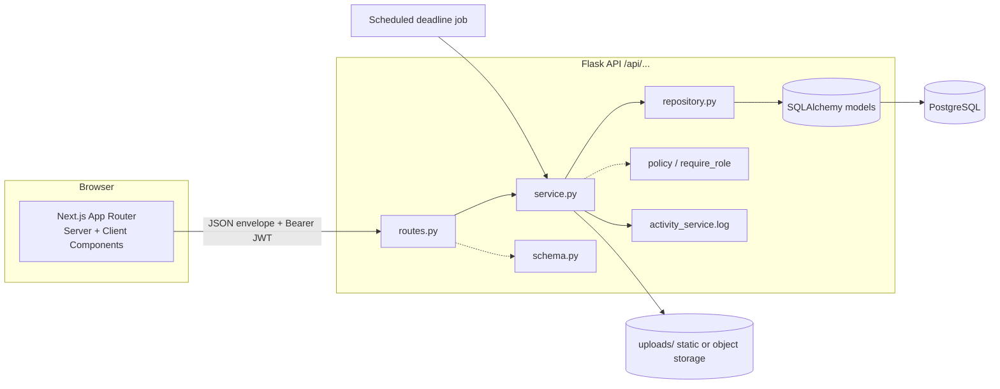
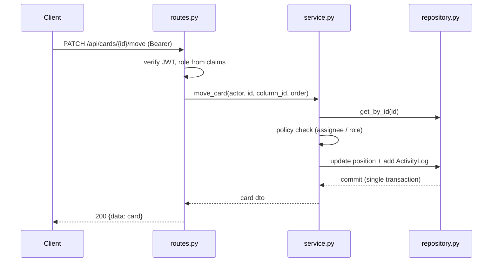
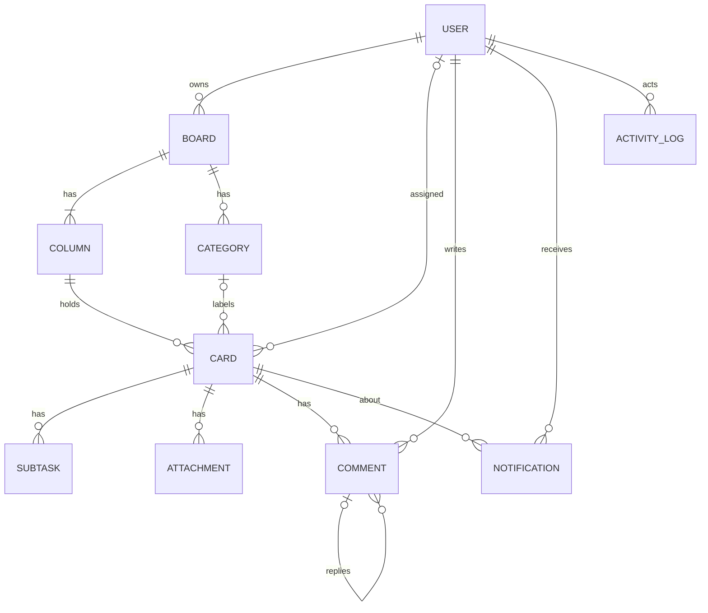

# Design Document

## Overview

This document is the technical design for the Kanban Task Management application (Version V1). It implements `requirements.md` using the stack and conventions fixed in the workspace steering: a Flask + SQLAlchemy REST API organized as one blueprint per domain, and a mobile-first Next.js (App Router, TypeScript) frontend.

Key design decisions:

| Decision | Choice | Rationale |
|---|---|---|
| Backend layering | `routes.py → service.py → repository.py → model`, plus `schema.py` | Services are unit-testable against a fake repository (Req 15.4, 13.7). |
| Authorization | One `require_role(...)` decorator plus per-resource policy functions in each service | The role always comes from the Token (Req 2.7). Ownership rules (member edits own assigned card, supervisor analytics for owned board) need data, so they live in services, not only in decorators. |
| Role model | Numeric rank for guest < member < supervisor < manager, with admin as a separate capability set | Additive hierarchy without duplicated rules (Req 2.2, 2.3). |
| Auth transport | JWT bearer token in the `Authorization` header, hashed passwords (werkzeug `generate_password_hash`) | No cookies, so CORS needs no credentials (Req 13.8). |
| Ordering | `Float` `order` with averaging on drop | A move rewrites one row (Req 5.1). |
| Deletion | `deleted_at` / `archived_at` on Board and Card, never a hard delete | Req 3.8, 4.23. |
| Audit | `ActivityLog` row written by the service in the same transaction as the change | Req 8.1. |
| Guest privacy | Serializers omit `comments`, `activity`, `activity_log` for guests; comment and activity endpoints reject guests | Absence of the field is the access control (Req 7.16, 8.5, 14.3). |
| Attachments | Files saved under a static `uploads/` route (or object storage); API returns a direct `file_url` | Req 4.18. |
| Deadline job | A scheduled job (APScheduler or a platform cron calling a CLI command `flask notify-deadlines`) | Req 9.2. |
| Frontend rendering | Server Components by default; Client Components only for the board (drag-and-drop), card modal, comment composer, sort toggle, search input, side panel | Req 14.11. |

### Data model addition beyond the current steering

`Board.owner_id` is a nullable UUID foreign key to `User` (Board_Owner, a supervisor). It is required by Req 3.2 and Req 10.1/10.2. `data-model.md` steering does not yet list it, so this design adds it and flags it for steering sync.

### Research summary

- Flask blueprints, application factory, and `flask-cors` with an explicit origin list are standard and match the steering. See the [Flask blueprint docs](https://flask.palletsprojects.com/en/latest/blueprints/).
- `flask-jwt-extended` provides `create_access_token` and `get_jwt()`. Claims (user id, role) are signed, so the role cannot be forged from a request body. See the [Flask-JWT-Extended docs](https://flask-jwt-extended.readthedocs.io/).
- Fractional (Float) ordering is the usual cheap reorder technique. Repeated averaging can exhaust float precision after roughly 50 consecutive inserts in the same gap, so the move service rebalances a column (renumbers `order` as 1.0, 2.0, ...) when the gap between neighbours falls below `1e-6`. This is an in-column rewrite, triggered rarely, and is the only case where sibling rows change.
- Property-based testing: `hypothesis` for Python services, `fast-check` for TypeScript pure helpers.

Content from these sources was summarized, not quoted.

## Architecture



### Backend layout

```
backend/app/
  __init__.py            # create_app(): config, CORS, db, blueprints, error handlers, CLI
  extensions.py          # db, migrate
  common/
    auth.py              # require_role, current_user, role rank
    errors.py            # AppError subclasses + envelope error handler
    responses.py         # ok(data, status=200)
    ordering.py          # between(a, b), needs_rebalance, rebalance
  models/                # one module per entity, UUID PKs, TimestampMixin
  blueprints/
    auth/ boards/ columns/ cards/ categories/ comments/
    notifications/ analytics/ users/     # each: routes.py service.py repository.py schema.py
  jobs/deadlines.py      # daily deadline notifications
backend/tests/           # pytest + hypothesis, fake repositories
```

The `activity` domain has no public blueprint of its own in the steering list. Activity reads are exposed through the `cards` blueprint (`GET /api/cards/{id}/activity`) and the `boards` blueprint (`GET /api/boards/{id}/activity`). Writes go through `common`-level `activity_repository.add(...)`, called by each service inside its own transaction.

### Frontend layout

```
frontend/
  app/
    (auth)/login/page.tsx, register/page.tsx
    (app)/layout.tsx                 # Sidebar + Main shell, side panel host
    (app)/boards/[id]/page.tsx       # Server Component, fetches board
    (app)/boards/[id]/categories/page.tsx
    (app)/admin/users/page.tsx
  components/shared/                 # BaseButton, BaseBadge, BaseModal
  components/                        # Sidebar, Board (client), CardModal (client), ...
  lib/api.ts                         # single envelope unwrap/throw
  lib/ordering.ts                    # pure drop-order computation
  lib/commentTree.ts                 # pure helpers (view only; ordering is server-side)
  styles/tokens.css                  # prototype :root custom properties
```

### Request flow for a mutating call



## Components and Interfaces

### Cross-cutting backend components

- **`common/auth.py`**
  - `ROLE_RANK = {"guest": 0, "member": 1, "supervisor": 2, "manager": 3}`; `admin` is outside the ladder.
  - `has_at_least(role, minimum)` returns true for ranked roles only.
  - `require_role(*roles)` decorator: reads the JWT claims, returns 401 when absent or invalid, 403 when the role is not listed. Never reads `role` from the request body.
  - `Actor` dataclass `(id, role)` passed to services so services never touch Flask globals.
- **`common/errors.py`**: `ValidationError` (400, `VALIDATION_ERROR`), `Unauthorized` (401), `Forbidden` (403), `NotFound` (404), `Conflict` (409). One handler renders `{ "error": { "code", "message" } }`. Unhandled exceptions return 500 with the same shape.
- **`common/responses.py`**: `ok(payload)` returns `{ "data": payload }`.
- **`common/ordering.py`**: pure functions `between(prev, next)`, `needs_rebalance(prev, next)`, `rebalance(items)`.
- **CORS**: `CORS(app, origins=os.environ["ALLOWED_ORIGINS"].split(","))`. The app fails to start if the variable is missing or contains `*`.

### Role policy matrix (service layer)

| Action | guest | member | supervisor | manager | admin |
|---|---|---|---|---|---|
| View public board columns/cards | yes | yes | yes | yes | yes |
| View any non-deleted board | no | yes | yes | yes | yes |
| View comments / activity | no | yes | yes | yes | yes |
| Create board, assign owner, archive board, soft-delete board | no | no | no | yes | yes |
| Set visibility | no | no | yes | yes | yes |
| Create column | no | no | yes | yes | yes |
| Create / delete / archive card | no | no | yes | yes | yes |
| Edit / move card | no | own assigned only | any visible | any visible | any visible |
| Assign card | no | no | yes | yes | yes |
| Manage categories | no | no | yes | yes | yes |
| Create comment / reply | no | yes | yes | yes | no |
| Flag comment priority | no | no | no | yes | no |
| Board analytics | no | no | owned board only | any board | no |
| Cross-board analytics | no | no | no | yes | no |
| Manage users | no | no | no | no | yes |

Board visibility for supervisors and members follows Req 11.6: any non-deleted board is returned to a signed-in user regardless of `visibility`. A guest receives only `public` boards (list) or 403 for a private board.

### Blueprints, endpoints, and service functions

All paths are under `/api`. Every response uses the envelope.

**auth**
- `POST /auth/register` → `auth_service.register(full_name, email_or_username, password)`; 400 on missing fields, 409 on duplicate. New accounts get role `member`.
- `POST /auth/login` → `auth_service.login(...)`; 401 on bad credentials. Both return `{ user: {id, full_name, email_or_username, avatar_url}, token }`.

**users** (admin only)
- `GET /users`, `POST /users`, `PATCH /users/{id}` (edit, assign role). Each mutation logs an `ActivityLog` row (`user.created`, `user.updated`, `user.role_changed`).

**boards**
- `GET /boards` (guest sees public only), `GET /boards/{id}`, `POST /boards` (manager, admin; seeds columns), `PATCH /boards/{id}` (name, `owner_id`, `visibility`), `POST /boards/{id}/archive`, `POST /boards/{id}/unarchive`, `DELETE /boards/{id}` (soft), `GET /boards/{id}/activity`.
- `GET /boards/{id}/cards?search=&filter[priority]=&filter[assignee]=&filter[category]=` (served by the `cards` blueprint, nested under boards per API conventions).
- Board detail for a guest: `serialize_board(board, viewer)` omits `comments` and `activity_log` even if requested.

**columns**
- `POST /boards/{board_id}/columns` (supervisor, manager, admin) appends with `order = max + 1`.

**cards** (subtasks and attachments are sub-resources; no separate blueprint)
- `POST /columns/{column_id}/cards`, `GET /cards/{id}`, `PATCH /cards/{id}`, `DELETE /cards/{id}` (soft), `POST /cards/{id}/archive`, `POST /cards/{id}/unarchive`, `PATCH /cards/{id}/move`, `GET /cards/{id}/activity`.
- `POST /cards/{id}/subtasks`, `PATCH /subtasks/{id}`, `DELETE /subtasks/{id}`.
- `POST /cards/{id}/attachments` (JSON link or multipart upload), `DELETE /attachments/{id}`.
- `card_service` exposes `add_subtask`, `toggle_subtask`, `reorder_subtasks`, `delete_subtask`, `move_card`, `assign_card`, `list_for_board(filters)`.

**categories**
- `GET /boards/{board_id}/categories` (board access only), `POST /boards/{board_id}/categories`, `PATCH /categories/{id}`, `DELETE /categories/{id}` (the last three need supervisor, manager, or admin). Deleting a category sets `Card.category_id` to null for affected cards.

**comments**
- `GET /cards/{id}/comments?sort=latest|popular`, `POST /cards/{id}/comments`, `POST /comments/{id}/replies`, `PATCH /comments/{id}/priority`. No like endpoint.
- `comment_service.list_for_card(card_id, sort, viewer)` returns priority comments first (newest first), then the rest in the requested order, replies nested oldest-first, and `can_create_card` computed per comment.

**notifications**
- `GET /notifications` returns `{ items, unread_count }` for the caller only. `PATCH /notifications/{id}/read` marks one read.

**analytics**
- `GET /boards/{id}/analytics` and `GET /analytics/boards` (manager, one summary per board).

### Key service algorithms

**Move card (`card_service.move_card`)**
1. Load card; reject 404 if soft-deleted.
2. Policy: member allowed only if `card.assignee_id == actor.id`; supervisor, manager, admin allowed on any visible card; otherwise 403.
3. Client sends `column_id` and the neighbour orders (`prev_order`, `next_order`) or a computed `order`. The service recomputes with `ordering.between(prev, next)` and ignores a client value that disagrees, so a forged order cannot break sibling ordering.
4. If `needs_rebalance`, renumber that column's cards and recompute.
5. Update card, insert one `ActivityLog` (`card.moved`, metadata `{from_column, to_column}`), commit once.

**Comment listing (`comment_service.list_for_card`)**
1. Guest → `Forbidden` (the route also omits the field for card payloads).
2. Fetch top-level comments with replies.
3. Partition into `is_priority` and the rest. Sort priority by `created_at` desc. Sort the rest by `created_at` desc for `latest`, or by `(reply_count desc, created_at desc)` for `popular`.
4. Sort each reply list by `created_at` asc.
5. Set `can_create_card = viewer.role in {supervisor, manager, admin} and author.role == "manager"` (Req 7.14, 7.15).

**Reply (`comment_service.reply`)**: load the target; if `target.parent_id is not None` raise `ValidationError("cannot reply to a reply")`; insert reply; `parent.reply_count += 1`; log activity; commit once.

**Assignment (`card_service.assign_card`)**: set `assignee_id`, insert `Notification(type="assigned")`, insert `ActivityLog(card.assigned)`, commit once.

**Deadline job (`jobs/deadlines.run(today)`)**: select cards with `end_date == today`, `deleted_at is null`, `assignee_id is not null`; for each, insert a `deadline` notification unless one already exists for `(card_id, user_id, date)`. A unique constraint on `(user_id, card_id, type, notify_date)` makes reruns idempotent.

**Analytics (`analytics_service.summary`)**: one grouped SQL query per board, returning `done`, `in_progress`, `overdue`, `total`, and a delta versus the previous 7 days (`done_delta`). "Done" is the column named `Done`; "overdue" is a non-done card with `end_date < today`.

**Card filtering**: `search` matches `title` and `description` case-insensitively; `filter[priority|assignee|category]` combine with AND; unknown filter keys raise `ValidationError`; `deleted_at is null` always applies.

### Frontend components

| Component | Type | Notes |
|---|---|---|
| `AppShell` (`(app)/layout.tsx`) | Server | Renders Sidebar, header, Main, side-panel host. |
| `Sidebar` | Client | Off-canvas drawer below 960px, scrim, toggle in persistent header. Boards list is the board switcher. Categories entry only for supervisor, manager, admin. |
| `SidePanel` | Client | One `toggleSidePanel("inbox" \| "activity")` shared by sidebar items and the header bell. Renders only when the API returned the data. |
| `Board` | Client | Drag-and-drop with placeholder and FLIP, calls `PATCH /cards/{id}/move` on `dragend`, reconciles with the response. |
| `FilterRow` | Client | Chips from `GET /boards/{id}/categories`; search input. |
| `CardModal` | Client | Two panes. Left: title, description, priority, dates, attachments, subtasks, activity. Right: `CommentThread` and `CommentComposer`. |
| `CardDescription`, `ActivityList`, `AttachmentList` | Server | Plain rendering; attachments use `target="_blank" rel="noopener noreferrer"`. |
| `SubtaskChecklist` | Client | Flat checkbox list, inline-editable titles, drag handle. |
| `CommentThread` | Client | Priority first, Latest/Popular toggle with reply-count badge, Reply only where `parentId === null`, create-card button only where `comment.canCreateCard`. |
| `CategoriesScreen` | Client | CRUD scoped to the current board. |
| `AuthSplitLayout` | Server | Brand panel hidden at mobile width; form card elevated and rounded. |
| `BaseButton`, `BaseBadge`, `BaseModal` | Shared | Only place buttons, badges, and modals are defined; styled from `tokens.css` variables. |

`lib/api.ts` is the single fetch wrapper: it adds the Bearer token, unwraps `{ data }`, and throws a typed `ApiError` built from `{ error }`. Styles use `min-width` queries (960px breakpoint) over a 360 to 414px base, and only CSS custom properties.

Stretch features (Req 16) are designed as additive: nullable `progress`, `views_count` columns in a later migration, and the decorative tabs rendered in `CardModal` behind a feature flag. They are not in the first migration.

## Data Models

All primary keys are `UUID` (`default=uuid.uuid4`). Every table has `created_at` and `updated_at` (`TimestampMixin`).



| Entity | Columns |
|---|---|
| `User` | `id`, `full_name`, `email_or_username` (unique), `password_hash`, `role` enum(`member`,`supervisor`,`manager`,`admin`), `avatar_url` (nullable), timestamps. Guest is the absence of a user. |
| `Board` | `id`, `name`, `visibility` enum(`public`,`private`, default `private`), **`owner_id` (nullable FK User)**, `deleted_at`, `archived_at`, timestamps. |
| `Column` | `id`, `board_id` (FK, cascade), `name`, `order` (Float), timestamps. |
| `Card` | `id`, `column_id`, `category_id` (nullable FK, `ON DELETE SET NULL`), `assignee_id` (nullable FK), `title`, `description`, `priority` enum(`high`,`medium`,`low`), `start_date` (nullable Date), `end_date` (nullable Date), `order` (Float), `deleted_at`, `archived_at`, timestamps. Check constraint `end_date >= start_date` when both set. Stretch: `progress`, `views_count`. |
| `Category` | `id`, `board_id` (FK, `ON DELETE CASCADE`), `name`, `color` (nullable), timestamps. Unique `(board_id, name)`. |
| `Subtask` | `id`, `card_id` (FK), `title`, `is_done` (default false), `order` (Float), timestamps. |
| `Attachment` | `id`, `card_id`, `url` (nullable), `file_path` (nullable), `mime_type` (nullable), `name`, timestamps. Check constraint: `url IS NOT NULL OR file_path IS NOT NULL`. Allowed upload MIME types: PDF, Word (`.doc`, `.docx`), RAR. |
| `Comment` | `id`, `card_id`, `author_id`, `parent_id` (nullable self FK), `content`, `is_priority` (default false), `reply_count` (default 0), timestamps. |
| `ActivityLog` | `id`, `actor_id`, `action`, `target_type`, `target_id`, `metadata` (JSON), `created_at`. Append-only; no `updated_at` writes, and the repository exposes no update or delete function. |
| `Notification` | `id`, `user_id`, `type` enum(`assigned`,`deadline`), `card_id`, `is_read` (default false), `notify_date` (Date), timestamps. Unique `(user_id, card_id, type, notify_date)` for `deadline` idempotency. |

Notes:
- Card queries add `deleted_at IS NULL` by default. Boards do the same.
- `ActivityLog` has no `updated_at` because it is never updated. This is a deliberate deviation from "every entity has `updated_at`" in the steering, which the append-only rule takes priority over. Flagged for steering sync.
- An ActivityLog board feed joins cards and columns belonging to the board by `target_type` and `target_id`.

### API payload shapes (examples)

```json
{ "data": { "id": "…", "title": "Fix login", "priority": "high", "order": 1.5,
  "column_id": "…", "category_id": null, "assignee_id": "…",
  "start_date": "2025-01-01", "end_date": "2025-01-05",
  "subtasks": [], "attachments": [{ "id": "…", "name": "spec.pdf", "file_url": "https://…/uploads/…/spec.pdf" }],
  "comments": [], "activity": [] } }
```

Guest card payloads omit `comments` and `activity` entirely.

```json
{ "data": [ { "id": "…", "content": "…", "is_priority": true, "reply_count": 3,
  "can_create_card": true, "author": { "id": "…", "role": "manager" },
  "replies": [ { "id": "…", "parent_id": "…", "content": "…" } ] } ] }
```

## Correctness Properties

*A property is a characteristic or behavior that should hold true across all valid executions of a system-essentially, a formal statement about what the system should do. Properties serve as the bridge between human-readable specifications and machine-verifiable correctness guarantees.*

Reflection notes: the many per-endpoint 403/401 criteria collapse into one permission-matrix property. The activity-row criteria collapse into one "exactly one row per state change" property. All guest-privacy criteria (7.16, 8.5, 11.7, 12.6, 14.3) collapse into one property. Assignment notification (4.11, 9.1) is one property. Comment ordering (7.9 to 7.12) is split into the top-level ordering and the reply ordering because they vary independently.

### Property 1: Registration and login round trip

*For any* valid registration (non-empty full name, unique email or username, non-empty password), registering returns a user and token, the stored password hash differs from the plaintext, and logging in with the same credentials returns the same user shape and a valid token. *For any* different password, login returns 401.

**Validates: Requirements 1.1, 1.2, 1.3**

### Property 2: Registration input validation

*For any* registration payload with at least one required field missing or blank, the Backend returns 400 `VALIDATION_ERROR` and creates no user. *For any* registration reusing an existing email or username, the Backend returns 409 and the user count is unchanged.

**Validates: Requirements 1.4, 1.5**

### Property 3: Permission matrix and role source

*For any* (role, action) pair, where role is one of guest, member, supervisor, manager, admin, the permission function allows the action exactly when the policy matrix allows it. Ranked roles are monotonic: *for any* action allowed to a role, every higher ranked role is also allowed it. The result is independent of any `role` value present in the request body. Unauthenticated requests yield 401 and unpermitted authenticated requests yield 403.

**Validates: Requirements 2.1, 2.2, 2.3, 2.4, 2.5, 2.6, 2.7, 2.8, 2.9, 3.3, 3.5, 3.7, 4.4, 4.7, 6.4, 7.3, 7.8, 10.4, 11.3, 11.9**

### Property 4: Board creation seeds default columns

*For any* valid board name created by a manager or admin, the board has exactly five columns named Todo, In Progress, Review, Revision, Done with `order` values 0 to 4 in that sequence.

**Validates: Requirements 3.1**

### Property 5: Column append order

*For any* board with any existing columns, creating a column gives it an `order` strictly greater than every existing column's `order`.

**Validates: Requirements 3.4**

### Property 6: Soft delete hides without removing

*For any* board or card, soft-deleting it sets `deleted_at`, keeps the row in storage, and excludes it from default list, search, and filter results.

**Validates: Requirements 3.6, 3.8, 4.5, 4.23, 12.3**

### Property 7: Archive round trip

*For any* board or card, archiving then unarchiving restores `archived_at` to null and leaves every other field unchanged.

**Validates: Requirements 4.6, 11.8, 11.10**

### Property 8: Card field validation

*For any* card submission whose priority is not one of `high`, `medium`, `low`, or whose `end_date` is earlier than `start_date`, the Backend returns 400 `VALIDATION_ERROR` and stores nothing. *For any* valid submission, the card is stored with the submitted values.

**Validates: Requirements 4.1, 4.2, 4.3**

### Property 9: Member edit and move scope

*For any* card and any member, an edit or move succeeds exactly when the card's `assignee_id` equals the member's id. *For any* supervisor, manager, or admin, edits and moves of any visible card succeed.

**Validates: Requirements 4.8, 4.9, 4.10, 5.4, 5.5, 5.6**

### Property 10: Assignment creates one notification atomically

*For any* card and any assignee, assigning the card sets `assignee_id` and creates exactly one `assigned` notification for that user. If the commit fails, neither change persists.

**Validates: Requirements 4.11, 9.1**

### Property 11: Subtask toggle round trip and deletion

*For any* subtask, toggling `is_done` twice returns it to its original state, and deleting it removes it from its card's subtask list. *For any* new subtask, `is_done` is false.

**Validates: Requirements 4.12, 4.13, 4.14**

### Property 12: Attachment validity

*For any* attachment submission, it is accepted exactly when it has a `url`, or a `file_path` with a MIME type in {PDF, Word, RAR}. Submissions with neither, or with another file type, return 400 `VALIDATION_ERROR`.

**Validates: Requirements 4.15, 4.16, 4.17**

### Property 13: Drop order lies between neighbours

*For any* two sibling orders a < b, the computed drop order is strictly between a and b and equals their average. *For any* sequence of drops, no sibling row other than the moved card changes unless a rebalance is triggered, and after any rebalance the relative order of all cards is preserved.

**Validates: Requirements 5.1**

### Property 14: Move persists and logs exactly once

*For any* successful move to a column and position, reloading the column's cards sorted by `order` shows the card at that position, and exactly one `card.moved` activity row exists for that move, with the source and target column.

**Validates: Requirements 5.8, 5.9**

### Property 15: Categories are board-scoped

*For any* set of categories distributed across boards, listing a board's categories returns exactly the categories whose `board_id` equals that board, for any viewer with access to the board, including a guest on a public board.

**Validates: Requirements 6.5, 6.6, 6.7**

### Property 16: Blank comments rejected

*For any* comment body that is empty or only whitespace, creating a comment returns 400 `VALIDATION_ERROR` with message `content is required` and stores nothing. *For any* non-blank body from an allowed role, a top-level comment with null `parent_id` is created.

**Validates: Requirements 7.1, 7.2**

### Property 17: Reply count invariant and depth cap

*For any* top-level comment with n successful replies, its `reply_count` equals n. *For any* reply target that already has a non-null `parent_id`, the Backend returns 400 and creates nothing.

**Validates: Requirements 7.4, 7.5**

### Property 18: Priority flag toggle round trip

*For any* comment, a manager toggling `is_priority` twice returns it to its original value, and any non-manager toggle returns 403 and leaves it unchanged.

**Validates: Requirements 7.7, 7.8**

### Property 19: Top-level comment ordering

*For any* set of comments and any `sort` in {latest, popular, omitted}, the listing places all priority comments first ordered by `created_at` descending, followed by the remaining top-level comments ordered by `created_at` descending for latest and omitted, or by `(reply_count desc, created_at desc)` for popular.

**Validates: Requirements 7.9, 7.10, 7.11**

### Property 20: Reply ordering independent of sort

*For any* top-level comment and any `sort` value, its replies are nested inline and ordered by `created_at` ascending.

**Validates: Requirements 7.12**

### Property 21: Comment flags

*For any* returned comment and viewer, the comment includes `reply_count`, `is_priority`, and `can_create_card`, and `can_create_card` is true exactly when the viewer is a supervisor, manager, or admin and the comment author's role is manager, independent of `is_priority`.

**Validates: Requirements 7.13, 7.14, 7.15**

### Property 22: Guest responses never include comments or activity

*For any* guest request to a board, card, search, or direct comment or activity endpoint, the response contains no `comments`, `activity`, or `activity_log` field, even when the request asks for them explicitly.

**Validates: Requirements 7.16, 8.5, 11.7, 12.6, 14.3**

### Property 23: One activity row per state change

*For any* successful state-changing service call, exactly one `ActivityLog` row is inserted with the actor, action, target type, and target id, in the same transaction. *For any* failed call, no row is inserted.

**Validates: Requirements 8.1**

### Property 24: Activity queries return the right rows

*For any* set of activity rows, a card's activity is exactly the rows with `target_type = card` and `target_id` equal to that card, and a board's feed is exactly the rows for cards and columns belonging to that board.

**Validates: Requirements 8.3, 8.4**

### Property 25: Deadline job notifies once

*For any* set of cards and any date, running the job creates one `deadline` notification for each card whose `end_date` equals that date, whose `deleted_at` is null, and that has an assignee, and none for other cards. *For any* number of repeated runs on the same date, the notification set is the same as after one run.

**Validates: Requirements 9.2, 9.3**

### Property 26: Inbox isolation

*For any* set of notifications across users, a user's inbox contains exactly that user's notifications, and `unread_count` equals the number of those with `is_read` false.

**Validates: Requirements 9.5**

### Property 27: Analytics access and correctness

*For any* board and requester, analytics are returned exactly when the requester is a manager, or a supervisor whose id equals the board's `owner_id`; otherwise 403 (or 401 without a token). *For any* set of cards, the returned `done`, `in_progress`, and `overdue` counts equal counts computed directly from the cards, excluding soft-deleted ones, and the payload contains no per-card data.

**Validates: Requirements 10.1, 10.2, 10.3, 10.4, 10.5**

### Property 28: Guest board visibility

*For any* set of boards, a guest's board list contains exactly the boards with `visibility = public` and null `deleted_at`, and a guest request for a private board returns 403. A signed-in user can fetch any non-deleted board.

**Validates: Requirements 11.4, 11.5, 11.6**

### Property 29: Search and filter correctness

*For any* set of cards and any combination of `search` and `filter[priority|assignee|category]`, every returned card is on the board, not soft-deleted, matches the search text, and matches every supplied filter, and no matching card is omitted. Adding a filter never increases the result set. An unsupported filter field returns 400 `VALIDATION_ERROR`.

**Validates: Requirements 12.1, 12.2, 12.4**

### Property 30: Response envelope

*For any* endpoint and any request, a success response body is exactly `{ "data": … }` and a failure response body is exactly `{ "error": { "code", "message" } }` with a status in {400, 401, 403, 404, 409}.

**Validates: Requirements 13.2, 13.3, 13.4**

## Error Handling

| Condition | Status | Code |
|---|---|---|
| Missing or malformed body field, bad priority, `end_date < start_date`, unsupported filter, bad attachment, blank comment, reply to a reply | 400 | `VALIDATION_ERROR` |
| Missing, invalid, or expired token; bad login credentials | 401 | `UNAUTHORIZED` |
| Role or ownership check fails; guest requests private board, comments, or activity | 403 | `FORBIDDEN` |
| Unknown or soft-deleted resource id | 404 | `NOT_FOUND` |
| Duplicate email or username, duplicate category name on a board | 409 | `CONFLICT` |
| Unhandled exception | 500 | `INTERNAL_ERROR` (generic message, details logged server-side only) |

- Services raise `AppError` subclasses; one registered handler renders the envelope. Routes contain no try/except.
- Every service call that writes runs in one transaction. On any exception the session rolls back, so no partial state or orphan `ActivityLog` row remains.
- A 404 is returned for a resource that exists but is soft-deleted, so deleted data is not revealed.
- Frontend: `lib/api.ts` throws `ApiError(code, message, status)`. A 401 clears the session and redirects to login. A 403 shows an inline message. A failed move reverts the card to its pre-drag position using the previous local state.
- Startup validation: the app refuses to start when `ALLOWED_ORIGINS` is missing or contains `*`, or when `JWT_SECRET` is missing.
- Upload errors (wrong type, oversize) return 400 before anything is written to storage.

## Testing Strategy

### Approach

Property-based testing applies to the service layer, because services are pure business logic running against fake repositories (permission matrix, ordering, comment sorting, validation, analytics counting, deadline selection). It does not apply to UI rendering, layout, or plain CRUD wiring, which use example-based and end-to-end tests.

### Property-based tests

- Libraries: `hypothesis` for the backend, `fast-check` for TypeScript helpers (`lib/ordering.ts`).
- Each of Properties 1 to 30 is implemented by a single property-based test, run with at least 100 iterations (`@settings(max_examples=100)`).
- Each test carries a tag comment in the form `Feature: kanban-task-management, Property N: <property text>`.
- Services are tested against in-memory fake repositories, never a real database. Properties that need atomicity (10, 14, 23) use a fake unit of work that can be forced to fail.
- Property 30 runs against the Flask test client with the real routes and fake repositories, over generated requests to every registered route.

### Unit and example tests (pytest)

- Comment creation: success, validation failure (blank body), unauthenticated (401), unauthorized (guest and admin, 403). This is mandatory per Req 15.1.
- Board seed order, owner assignment, cross-board analytics shape, CORS origin parsing (rejects `*`), `file_url` shape.
- `ActivityLog` repository exposes no update or delete function.
- Static check: no `.query` call outside a `repository.py` file; every mutating route has a role guard (Req 2.10, 13.7).
- Category deletion sets affected cards' `category_id` to null; deleting a board cascades its categories (integration test with a test database).

### Frontend tests

- Component tests (React Testing Library): `CommentThread` shows Reply only on top-level comments and the create-card button only when `canCreateCard`; sections are omitted when the API omits `comments`, `activity`, or inbox data; filter chips come from the API response.
- Pure helper tests: `computeDropOrder` (fast-check, Property 13 mirror).
- Responsive checks at 360, 414, and 960 pixel widths via Playwright viewport tests.

### End-to-end (Playwright)

- One Kanban journey against the deployed URL: register, log in, open a board, add and drag a card, reload and confirm position, open the card modal, comment, reply, toggle Latest and Popular.
- No `waitForTimeout` anywhere; use `expect(locator).toBeVisible()` and other web-first assertions (Req 15.3). A CI grep step fails the build if `waitForTimeout` appears.
- Performance (Req 14.1, 14.2) is checked by a load script for p95 latency and a Lighthouse run on a 200-card seeded board with Fast 3G throttling. These are integration checks, not property tests.

### Requirements not covered by automated tests

Visual qualities of the auth layout (1.9) and the FLIP animation (5.3) are verified by manual review against `design/kanban-prototype.html`.
