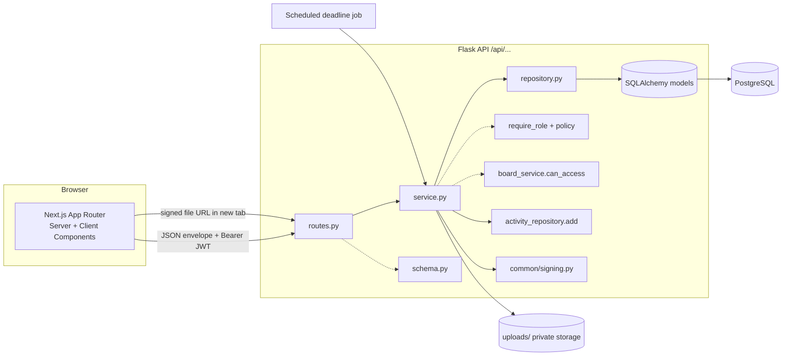
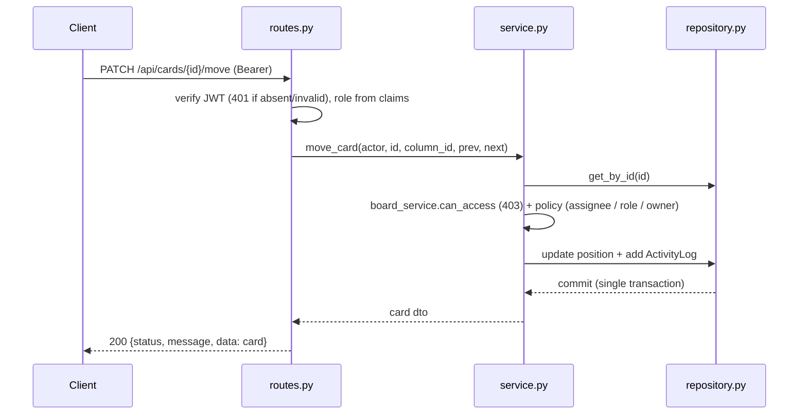
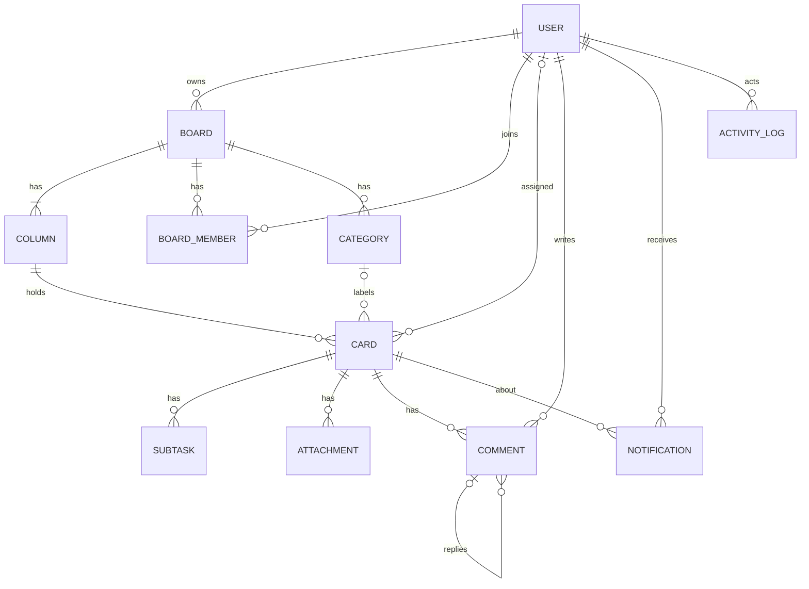

# Design Document

## Overview

This document is the technical design for the Kanban Task Management application (Version V8). It implements the V8 `requirements.md` using the stack and conventions fixed in the workspace steering (already updated to V7): a Flask + SQLAlchemy + flask-smorest REST API (marshmallow schemas, generated OpenAPI) organized as one blueprint per domain, and a mobile-first Next.js (App Router, TypeScript) frontend. Requirement references use the V7 criterion numbers. "Decision A" to "Decision H" refer to the Decisions Log in `requirements.md`.

Key design decisions:

| Decision | Choice | Rationale |
|---|---|---|
| Backend layering | `routes.py → service.py → repository.py → model`, plus `schema.py` holding the marshmallow schemas. Routes are `flask_smorest.Blueprint` views; services and repositories never import marshmallow or Flask | Services are unit-testable against a fake repository (Req 15.4, 13.7, 13.14). |
| Board access | `board_service.can_access(user, board)` (Board_Access) gates every board-scoped read and comment; `board_service.can_write_staff(user, board)` (Board_Staff_Access) gates Supervisor, Manager, and Admin writes (Decision A) | "Private" must gate unrelated signed-in users and cannot drift per endpoint (Req 11.6, 11.11, 12.7); an unrelated Supervisor must not write on a public Board (Req 3.4, 4.1, 6.1). |
| Authorization | `require_role(...)` decorator for the role gate, plus service-level policy functions that combine role, `can_access`, `can_write_staff`, and assignment | Role comes only from the Token (Req 2.7). Ownership and assignment rules need data, so they live in services. |
| Role model | Numeric rank for guest < member < supervisor < manager; admin is a separate capability set | Additive hierarchy without duplicated rules (Req 2.2, 2.3). Admin is deliberately not a Manager superset (Decision B). |
| Status codes | No Token returns 401; valid Token with insufficient role or access returns 403, everywhere. A Guest requesting a private Board gets 401 | Req 2.8, 2.9, 11.5, 12.7, 13.10. |
| Auth transport | Stateless JWT bearer token, fixed 24-hour expiry, no revocation list; passwords hashed with argon2 (`argon2-cffi`) | Req 1.13, 1.14, 1.16. Rate limiting is deferred (Req 1.18). |
| Login identity | One `login_identifier` column, unique case-insensitively through a functional unique index on `lower(login_identifier)` | Decision C, Req 1.1 to 1.5. |
| Ordering | `Float` `order`; first = `min - 1`, last = `max + 1`, empty = `1.0`, otherwise average; renumber the whole sibling list when the gap falls below `1e-6` | Req 4.13, 5.1, 5.10, 5.11. |
| Deletion | `deleted_at` / `archived_at` on Board and Card only; child rows are hidden through a join on the parent Card's `deleted_at` | Req 3.8, 4.23, 4.29. |
| Audit | `ActivityLog` row written by the service in the same transaction as the change | Req 8.1. |
| Guest privacy | Serializers omit `comments`, `activity`, `activity_log` for guests; comment and activity endpoints reject guests | Absence of the field is the access control (Req 7.16, 8.5, 14.3). |
| Attachment files | Signed, 15-minute file URLs (HMAC over attachment id and expiry); no permanent public URL (Decision D) | Req 4.18, 4.24 to 4.27. This replaces the V1 design, which returned a stable public `file_url`. |
| Deadline job | Scheduled job (APScheduler, or a platform cron calling `flask notify-deadlines`); "today" is computed in `APP_TIMEZONE` | Req 9.2. |
| Frontend rendering | Server Components by default; Client Components only for the board (drag-and-drop), card modal, comment composer, sort toggle, search input, side panel | Req 14.11. |
| Frontend styling | Tailwind CSS v4 + shadcn/ui (Radix). `styles/tokens.css` stays the single source of the look (palette from the product owner's visual reference); a Tailwind `@theme` block and shadcn's variables alias to the tokens. `BaseButton`, `BaseBadge`, `BaseModal` wrap shadcn `Button`, `Badge`, `Dialog`; nothing else imports `components/ui/` (Decision H) | Consistent utilities and accessible primitives while one token file carries the look (Req 14.9, 14.10, 14.13 to 14.15). |
| API framework | `flask-smorest`: one `Api` instance, every blueprint a `flask_smorest.Blueprint`, request and response declared with marshmallow schemas (Decision E) | One declaration per endpoint drives validation, serialization, and the OpenAPI document (Req 13.12, 17.1). |
| Response envelope | Success `{status: true, message, data}`; error `{status: false, message, error: {code, details?}}`; `status` is a boolean, true exactly when the HTTP status is 2xx; the numeric code travels on the HTTP line only; the message text appears once at the top level; mutating endpoints pass a descriptive message and reads default to "OK" (Decision G, supersedes the numeric `status` of Decision E) | The frontend unwraps in one place, branches on `error.code`, and two message strings cannot drift (Req 13.2 to 13.4, 13.11). |
| Validation status | smorest/webargs 422 is mapped to `400 VALIDATION_ERROR`; `error.details` maps each field to the list of marshmallow messages (Decisions E and G) | Req 13.13. |
| Relationships and loading | Five declared relationships (`Board.columns`, `Board.members`, `Card.subtasks`, `Card.attachments`, `Comment.replies`), `back_populates`, `lazy="raise"`, no cascade; each repository loads what its caller reads with `selectinload`/`joinedload` (Decision F) | An accidental lazy load fails in tests instead of becoming a hidden N+1 query; list endpoints keep a constant query count (Req 13.16, 13.18, 14.12). |
| Serialization | No `to_dict` on models; marshmallow schemas serialize, taking the viewer as context (Decision F) | Output depends on the viewer (guest privacy, `can_create_card`, signed file URLs), so it cannot live on the model (Req 13.17). |
| API documentation | Generated by smorest; Swagger UI and `/api/openapi.json` are enabled only through `OPENAPI_*` config when `APP_ENV` is `development` or `testing`; `flask export-openapi` writes `backend/openapi.json` | Req 17.1, 17.3 to 17.5. Replaces the hand-written `openapi.yaml`, `flask-swagger-ui`, and `pyyaml`. |

### Research summary

- Flask blueprints, application factory, and `flask-cors` with an explicit origin list match the steering. See the [Flask blueprint docs](https://flask.palletsprojects.com/en/latest/blueprints/).
- `flask-jwt-extended` provides `create_access_token(expires_delta=timedelta(hours=24))` and `get_jwt()`. Claims (user id, role) are signed, so the role cannot be forged from a request body. See the [Flask-JWT-Extended docs](https://flask-jwt-extended.readthedocs.io/).
- Case-insensitive uniqueness in PostgreSQL is done with a functional unique index on `lower(column)`. Lookups use `func.lower(...)` so the index is used.
- Signed expiring URLs: an HMAC-SHA256 over `"{attachment_id}.{exp}"` with a server secret, compared with `hmac.compare_digest`, gives a stateless token that a plain browser tab can present. `itsdangerous` offers an equivalent timed serializer; the explicit HMAC is chosen because the clock can be injected in tests.
- Fractional (Float) ordering is the usual cheap reorder technique. Repeated averaging exhausts float precision after roughly 50 consecutive inserts in the same gap, so the service renumbers the sibling list when the gap falls below `1e-6`.
- flask-smorest: `Api(app)` collects `flask_smorest.Blueprint`s; `@blp.arguments(Schema, location=...)` validates bodies and queries (webargs, default failure status 422); `@blp.response(status, Schema)` serializes and documents the response; `abort()` and `HTTPException` go through `Api.handle_http_exception`, which a subclass can override to render the project's error envelope. The OpenAPI document is served only when `OPENAPI_JSON_PATH` (with `OPENAPI_URL_PREFIX`) is set, and Swagger UI only when `OPENAPI_SWAGGER_UI_PATH` and `OPENAPI_SWAGGER_UI_URL` are set; leaving them unset registers no route. See the [flask-smorest docs](https://flask-smorest.readthedocs.io/).
- Property-based testing: `hypothesis` for Python services, `fast-check` for TypeScript pure helpers.

Content from these sources was summarized, not quoted.

## Architecture



### Backend layout

```
backend/app/
  __init__.py            # create_app(): config, CORS, db, blueprints, error handlers, CLI
  extensions.py          # db, migrate
  api.py                 # EnvelopeApi(flask_smorest.Api) instance, error mapping, OpenAPI config by APP_ENV, bearerAuth scheme, export-openapi CLI
  common/
    auth.py              # require_role, current_user, role rank, Actor
    errors.py            # AppError subclasses (plain Python, no Flask import)
    envelope.py          # envelope(DataSchema, many=False) -> marshmallow Schema {status: Boolean, message, data}; ErrorEnvelopeSchema {status, message, error{code, details}}
    responses.py         # ok(data, message=None, status=200) -> {status: true, message, data}; default message = "OK"
    ordering.py          # between(a, b), position_for(...), needs_rebalance, rebalance
    signing.py           # sign_file_url(attachment_id, now), verify_file_signature(...)
    clock.py             # today(tz), now(): injectable for tests
  models/                # one module per entity, UUID PKs, TimestampMixin
  blueprints/
    auth/ boards/ columns/ cards/ categories/ comments/
    notifications/ analytics/ users/     # each: routes.py service.py repository.py schema.py
  jobs/deadlines.py      # daily deadline notifications
backend/tests/           # pytest + hypothesis, fake repositories
backend/openapi.json     # generated export (flask export-openapi), never edited by hand
backend/API.md           # hand-written human-readable reference, same endpoints as the generated document
```

Activity has no public blueprint of its own. Activity reads are exposed through the `cards` blueprint (`GET /api/cards/{id}/activity`) and the `boards` blueprint (`GET /api/boards/{id}/activity`). Writes go through `activity_repository.add(...)`, called by each service inside its own transaction. Board members are handled inside the `boards` blueprint (`board_service`, `board_repository`); attachments are a sub-resource of `cards`.

### Environment variables (listed in each app's `.env.example`, never a real `.env`)

Backend: `DATABASE_URL`, `JWT_SECRET`, `ALLOWED_ORIGINS`, `FILE_URL_SECRET` (HMAC key for signed file URLs, separate from `JWT_SECRET`), `APP_TIMEZONE` (IANA name, for example `UTC`), `UPLOAD_DIR`, `APP_ENV` (`development`, `testing`, or `production`; optional, defaults to `production`; selects whether the smorest `OPENAPI_*` documentation settings are applied, see Requirement 17). Frontend: `NEXT_PUBLIC_API_URL`. The app refuses to start when `ALLOWED_ORIGINS`, `JWT_SECRET`, `FILE_URL_SECRET`, or `APP_TIMEZONE` is missing, or when `ALLOWED_ORIGINS` contains `*`.

### Backend dependencies

`requirements.txt` lists: `flask`, `flask-sqlalchemy`, `flask-migrate`, `flask-cors`, `flask-jwt-extended`, `argon2-cffi`, `psycopg[binary]` (or the driver in use), `flask-smorest` (brings `marshmallow`, `webargs`, `apispec`), and dev/test packages `pytest`, `hypothesis`. Removed: `flask-swagger-ui` and `pyyaml` (Req 17.10). Services and repositories import none of `flask`, `flask_smorest`, or `marshmallow`.

### Frontend layout

```
frontend/
  app/
    (auth)/login/page.tsx, register/page.tsx
    (app)/layout.tsx                 # Sidebar + Main shell, side panel host
    (app)/boards/[id]/page.tsx       # Server Component, fetches board
    (app)/boards/[id]/categories/page.tsx
    (app)/boards/[id]/members/page.tsx   # owner, Manager, Admin
    (app)/admin/users/page.tsx
  components/ui/                     # shadcn/ui primitives (Button, Badge, Dialog), imported only by components/shared/
  components/shared/                 # BaseButton, BaseBadge, BaseModal, BasePopover, BaseCalendar: thin wrappers over components/ui/
  components/                        # Sidebar, Board (client), CardModal (client), ...
  lib/api.ts                         # single envelope unwrap/throw
  lib/ordering.ts                    # pure drop-order computation
  lib/utils.ts                       # cn(): clsx + tailwind-merge
  styles/tokens.css                  # design tokens (single source of the look)
  styles/globals.css                 # @import "tailwindcss"; @theme mapping to the tokens; shadcn variable aliases; base layer
```

### Request flow for a mutating call



## Components and Interfaces

### Cross-cutting backend components

- **`common/auth.py`**
  - `ROLE_RANK = {"guest": 0, "member": 1, "supervisor": 2, "manager": 3}`; `admin` is outside the ladder.
  - `require_role(*roles)`: reads the JWT claims, returns 401 when absent or invalid, 403 when the role is not listed. Never reads `role` from the request body.
  - `Actor` dataclass `(id, role)`; a Guest is `None`. Services never touch Flask globals.
- **`common/errors.py`**: plain-Python `AppError` subclasses carrying `status`, `code`, and `message`: `ValidationError` (400, `VALIDATION_ERROR`), `Unauthorized` (401, `UNAUTHORIZED`), `Forbidden` (403, `FORBIDDEN`), `NotFound` (404, `NOT_FOUND`), `Conflict` (409, `CONFLICT`). They import nothing from Flask, so services can raise them.
- **`app/api.py`**: creates the single `Api` instance as `EnvelopeApi(Api)`. It registers every blueprint, declares the `bearerAuth` HTTP bearer scheme once, and owns all error mapping: `AppError` → its status and code (a `ValidationError` may carry `details`); smorest/webargs `422` → `400 VALIDATION_ERROR` with top-level `message` "Validation failed" and `error.details` built from the marshmallow `messages` (field name → list of message strings; location keys such as `json` or `query` are unwrapped); other `HTTPException`s (including 404 and 405) → their status with codes `NOT_FOUND`, `METHOD_NOT_ALLOWED`, etc.; any other exception → `500 INTERNAL_ERROR` with a generic message. Every error renders `{ "status": false, "message", "error": { "code", "details"? } }`; `details` appears only for `VALIDATION_ERROR`, and `error` has no `message` field (Decision G). The JWT error callbacks (missing, invalid, expired token) call the same renderer so they return the 401 envelope. `Api.ERROR_SCHEMA` is `ErrorEnvelopeSchema`, so error responses are documented with the same shape.
- **`common/envelope.py`**: `envelope(DataSchema, many=False)` returns (and caches) a marshmallow `Schema` subclass named `<DataSchema>Envelope` or `<DataSchema>ListEnvelope` with `status = Boolean`, `message = String`, and `data = Nested(DataSchema, many=many, allow_none=True)`. For `data: null` responses (logout) a `NullEnvelopeSchema` is used.
- **`common/responses.py`**: `ok(data, message=None, status=200)` returns `{ "status": true, "message": message or "OK", "data": data }`. The integer `status` argument is the HTTP status for the response line only and is not placed in the body; it must equal the status in the route's `@blp.response`. Mutating routes pass a short descriptive `message` such as `"Card moved"`; reads leave the default `"OK"`.
- **`common/ordering.py`**: pure functions (see Ordering below).
- **`common/signing.py`**: pure functions (see Attachments below).
- **Blueprint layering with flask-smorest**: each `routes.py` declares a `flask_smorest.Blueprint`, validates input with `@blp.arguments(XSchema)` (body) or `@blp.arguments(QuerySchema, location="query")`, declares output with `@blp.response(201, envelope(CardSchema))`, and marks protected operations with `@blp.doc(security=[{"bearerAuth": []}])`. The view calls one service function and returns `ok(dto, "Card created", 201)`. `schema.py` holds the marshmallow request, query, and payload schemas of the blueprint; `service.py` receives plain Python values (validated dicts) and returns plain DTOs, and imports neither marshmallow nor Flask. Rules that need data (uniqueness, access, ordering) stay in the service and raise `AppError`s.
- **Envelope rule**: the body `status` is a boolean, true exactly when the HTTP status is 2xx, and the numeric HTTP status is never in the body; `message` is a non-empty string stated once at the top level; mutating endpoints supply a descriptive message and reads default to "OK". The signed file route returns raw bytes on success and the error envelope on failure (Req 13.11). The documentation routes (`/api/docs`, `/api/openapi.json`) return the raw Swagger page and OpenAPI JSON and are the only responses outside the envelope (see V4 Revision Notes).
- **CORS**: `CORS(app, origins=os.environ["ALLOWED_ORIGINS"].split(","))`. No cookies are used, so `supports_credentials` stays off.

### Board access: `board_service.can_access(user, board)`

```python
def can_access(user: Actor | None, board: Board) -> bool:
    if board.deleted_at is not None:
        return False                      # callers translate to 404
    if board.visibility == "public":
        return True                       # guests and every signed-in user (Decision A)
    if user is None:
        return False                      # guest on private -> caller raises 401
    if user.role in ("manager", "admin"):
        return True
    return board.owner_id == user.id or board_repository.is_member(board.id, user.id)
```

Callers translate a `False` result with one helper, `require_access(user, board)`: soft-deleted board raises `NotFound`; a Guest on a private board raises `Unauthorized` (401); a signed-in user without access raises `Forbidden` (403). Every board-scoped read and write calls it: columns, cards (including search and filter), categories, comments, activity, attachments (including file URL issue), board members, and analytics. A Card, Column, Comment, Attachment, or Category resolves its Board first, then calls `require_access`.

A second helper, `can_write_staff(user, board)`, implements Board_Staff_Access. It is true for a Manager, an Admin, or a Supervisor who is the Board's owner or a BoardMember, and false for everyone else, including a Supervisor who is unrelated to a public Board.

```python
def can_write_staff(user: Actor | None, board: Board) -> bool:
    if user is None or board.deleted_at is not None:
        return False
    if user.role in ("manager", "admin"):
        return True
    return user.role == "supervisor" and (
        board.owner_id == user.id or board_repository.is_member(board.id, user.id))
```

Staff write paths call `require_access` first (401, 403, or 404), then `can_write_staff`, raising `Forbidden` when it is false. Member writes use `can_access` plus the assignee rule; comments use `can_access` plus the role rule. Board ownership alone, `is_owner(user, board)`, gates analytics for Supervisors and board member management together with Manager and Admin.

### Role policy matrix (service layer)

"Access" means `can_access` (Board_Access) is true. "Staff" means `can_write_staff` (Board_Staff_Access) is true. Every row also requires a valid Token unless the Guest column says yes.

| Action | guest | member | supervisor | manager | admin |
|---|---|---|---|---|---|
| List boards | public only | public + accessible | public + accessible | public + accessible | public + accessible |
| View a board's columns, cards, categories | public board | with Access | with Access | yes | yes |
| View comments / activity | no | with Access | with Access | yes | yes |
| Create board, assign or clear owner, archive board, soft-delete board | no | no | no | yes | yes |
| Set visibility | no | no | Staff | yes | yes |
| Add / remove BoardMember | no | no | owner only | yes | yes |
| Create column | no | no | Staff | yes | yes |
| Create / delete / archive card, assign or unassign | no | no | Staff | yes | yes |
| Edit / move card | no | own assigned only, with Access | Staff | yes | yes |
| Manage categories | no | no | Staff | yes | yes |
| Subtasks and attachments of a card | no | on own assigned card, with Access | Staff | yes | yes |
| Create comment / reply | no | with Access | with Access | with Access | no |
| Flag comment priority | no | no | no | yes | no |
| Board analytics | no | no | owned board only | any board | no |
| Cross-board analytics | no | no | no | yes | no |
| Manage users | no | no | no | no | yes |

Notes:
- Admin has no comment, reply, or priority-flag permission and no analytics permission. This is Decision B and is intentional.
- A Supervisor who is only a BoardMember has Board_Staff_Access and can manage the board's content but never gets analytics (Req 10.2, 10.7) and cannot add or remove BoardMembers (Req 3.12).
- Supervisor, Manager, and Admin writes (Card create, delete, archive, assign, unassign, edit, move; Subtask and Attachment writes; Column and Category writes; visibility) require Board_Staff_Access through `can_write_staff` (Req 3.4, 4.1, 4.4, 4.10, 6.1, 6.4, 11.2, 11.3). An unrelated Supervisor therefore cannot write on a public Board. Members keep Board_Access plus the assignee rule; reads and comments keep Board_Access.
- A user who cannot reach the board at all gets 401 (Guest) or 403 (signed-in) from `require_access` before the role check runs.

### Blueprints, endpoints, and service functions

All paths are under `/api`. Every response uses the envelope.

**auth**
- `POST /auth/register` → `auth_service.register(full_name, login_identifier, password)`. Trims the identifier. 400 when a field is missing or blank, the identifier exceeds 255 characters, or the password is shorter than 8 characters; 409 when `lower(login_identifier)` exists. New accounts get role `member`. No format validation of the identifier (Open Question 1).
- `POST /auth/login` → matches `lower(login_identifier)`; 401 on bad credentials. Register and login return the same `{ user: {id, full_name, login_identifier, avatar_url}, token }`.
- `POST /auth/logout` → returns `{ "status": true, "message": "Logged out", "data": null }`. Nothing is revoked. The client discards the token, which stays valid until expiry.

**users** (admin only)
- `GET /users`, `POST /users`, `PATCH /users/{id}` (edit, assign role). Each mutation logs an `ActivityLog` row (`user.created`, `user.updated`, `user.role_changed`). Non-admin returns 403, no token returns 401.

**boards**
- `GET /boards`: Guest gets public non-deleted boards; a signed-in user gets `(public AND deleted_at IS NULL) OR (non-deleted AND can_access)`. Implemented as one repository query `list_visible(user)`: Manager and Admin get every non-deleted board; others get public boards, boards where `owner_id = user.id`, and boards joined through `BoardMember`.
- `GET /boards/{id}` → `require_access`. `serialize_board(board, viewer)` omits `comments` and `activity_log` for a Guest even if requested.
- `POST /boards` (manager, admin; seeds columns in one transaction), `PATCH /boards/{id}` (name, `visibility`, `owner_id`), `POST /boards/{id}/archive`, `POST /boards/{id}/unarchive`, `DELETE /boards/{id}` (soft; manager, admin), `GET /boards/{id}/activity`.
- `PATCH /boards/{id}` with `owner_id`: the new value must reference a user with role `supervisor`, otherwise 400 `VALIDATION_ERROR`; `null` clears the owner. Reassigning or clearing writes one `board.owner_changed` activity row in the same transaction (Req 3.2, 3.16 to 3.19). Only Manager and Admin may change `owner_id`; a visibility change is also allowed to owner/BoardMember Supervisors (Req 11.2).
- `GET /boards/{id}/members` (requires `can_access`), `POST /boards/{id}/members` body `{ "user_id" }` (owner, Manager, Admin; 409 when the pair exists; 404 when the user does not exist), `DELETE /boards/{id}/members/{user_id}` (same actors; 404 when the pair does not exist). Each add or remove writes one `board.member_added` / `board.member_removed` activity row in the same transaction (Req 3.11 to 3.15).
- `GET /boards/{id}/cards?search=&filter[priority]=&filter[assignee]=&filter[category]=` is served by the `cards` blueprint, nested under boards per API conventions.

**columns**
- `POST /boards/{board_id}/columns` (`can_write_staff`: Manager, Admin, or owner/BoardMember Supervisor) appends with `order = max + 1`, or `0` when the board has no columns beyond the seeded ones (the seeded columns use `0..4`, so the next is `5`).

**cards** (subtasks and attachments are sub-resources; no separate blueprint)
- `POST /columns/{column_id}/cards`, `GET /cards/{id}`, `PATCH /cards/{id}` (including `assignee_id`), `DELETE /cards/{id}` (soft), `POST /cards/{id}/archive`, `POST /cards/{id}/unarchive`, `PATCH /cards/{id}/move`, `GET /cards/{id}/activity`.
- Setting `assignee_id` to a user creates an `assigned` Notification and a `card.assigned` activity row. Setting it to `null` writes a `card.unassigned` activity row and creates no Notification (Req 4.28).
- `POST /cards/{id}/subtasks`, `PATCH /subtasks/{id}` (`title`, `is_done`, `order` position), `DELETE /subtasks/{id}`.
- `POST /cards/{id}/attachments` (JSON link or multipart upload), `DELETE /attachments/{id}`.
- `GET /attachments/{id}/url` → `{ "status": true, "message": "OK", "data": { "file_url": "...", "expires_at": "..." } }` after `require_access` on the owning Card's Board; open to Guests on public boards (Req 4.26).
- `GET /attachments/{id}/file?exp=&sig=` serves the bytes after verifying the signature and expiry (see Attachments).
- `card_service` exposes `add_subtask`, `toggle_subtask`, `reorder_subtasks`, `delete_subtask`, `move_card`, `assign_card`, `list_for_board(filters)`, `issue_file_url`.

**categories**
- `GET /boards/{board_id}/categories` (`require_access` only, no role check; guests on public boards allowed), `POST /boards/{board_id}/categories`, `PATCH /categories/{id}`, `DELETE /categories/{id}` (the last three need `can_write_staff`). A duplicate name on the board, compared case-insensitively, returns 409 `CONFLICT` for create and rename. Deleting a category sets `Card.category_id` to null for affected cards. Categories of a soft-deleted board stay stored and are unreachable because `require_access` fails first.

**comments**
- `GET /cards/{id}/comments?sort=latest|popular`, `POST /cards/{id}/comments`, `POST /comments/{id}/replies`, `PATCH /comments/{id}/priority`. No like endpoint. Create and reply require a Member, Supervisor, or Manager with `can_access`; Admin gets 403.
- `comment_service.list_for_card(card_id, sort, viewer)` returns priority comments first (newest first), then the rest in the requested order, replies nested oldest-first, and `can_create_card` per comment.

**notifications**
- `GET /notifications` returns `{ items, unread_count }` for the caller only. `PATCH /notifications/{id}/read` and `PATCH /notifications/read-all` act only on the caller's rows. A foreign or unknown id on the single-row call returns 404.

**analytics**
- `GET /boards/{id}/analytics`: Manager any board; Supervisor only when `owner_id == actor.id` (a BoardMember Supervisor gets 403); Member and Admin get 403.
- `GET /analytics/boards` (Manager only; one summary per board).

### Key service algorithms

**Ordering (`common/ordering.py`, shared by cards and subtasks)**

`position_for(prev, next, siblings)` returns the new order, where `prev` and `next` are the orders of the neighbours the client dropped between (either may be absent):
- empty sibling list: `1.0`
- no `prev` (first position): `min_order - 1`
- no `next` (last position): `max_order + 1`
- both present: `(prev + next) / 2`

`needs_rebalance(prev, next)` is true when `next - prev < 1e-6`. In that case the service renumbers the whole sibling list as `1.0, 2.0, ...` preserving the current relative order, inside the same transaction, then recomputes the position from the renumbered neighbours. The service ignores any client-supplied `order` and recomputes it from neighbour ids.

**Move card (`card_service.move_card`)**
1. Load the card (404 if soft-deleted) and resolve its Board; `require_access` (401 or 403).
2. Policy: Member only if `card.assignee_id == actor.id`; Supervisor, Manager, Admin only if `can_write_staff`; otherwise 403.
3. Load the target column. If `target.board_id != card.board_id` raise `ValidationError` (400, Req 5.12).
4. Fetch the target column's other cards ordered by `order`. If the gap between the drop neighbours is below `1e-6`, renumber the column (excluding the moved card) and recompute the neighbours. Compute the order with `position_for`.
5. Update the card, insert one `ActivityLog` (`card.moved`, metadata `{from_column, to_column}`), commit once.

**Comment listing**: as V1 with these changes. A Guest calling a comment endpoint gets 403 on a public Board and 401 on a private Board, with no `comments` field in either case (Req 7.16); the card payload for a Guest omits `comments` entirely. For signed-in viewers, `require_access` runs first. `can_create_card = viewer.role in {supervisor, manager, admin} and author.role == "manager"` (Req 7.14, 7.15).

**Reply (`comment_service.reply`)**: load target; if `target.parent_id is not None` raise `ValidationError("cannot reply to a reply")`; `require_access`; insert reply; `parent.reply_count += 1`; log activity; commit once.

**Assignment (`card_service.assign_card`)**: set `assignee_id`; when non-null, insert `Notification(type="assigned", notify_date=today)`; insert `ActivityLog(card.assigned | card.unassigned)`; commit once.

**Deadline job (`jobs/deadlines.run(now)`)**: `today = now.astimezone(ZoneInfo(APP_TIMEZONE)).date()`. Select cards with `end_date == today`, `deleted_at is null`, `assignee_id is not null`; insert a `deadline` notification with `notify_date = today` for each, using `INSERT ... ON CONFLICT DO NOTHING` on the unique `(user_id, card_id, type, notify_date)`. Reruns add nothing. No per-user timezone is used (Req 9.2, 9.3).

**Analytics (`analytics_service.summary(today)`)**: one grouped SQL query per board returning `done`, `in_progress`, `overdue`, `total`, and `done_delta` versus the previous 7 days. "Done" is the column named `Done`. "Overdue" is a non-soft-deleted card with `end_date < today` whose column is not `Done`. `today` is in `APP_TIMEZONE`.

**Card filtering**: `search` is a case-insensitive substring match on `title` or `description`; `filter[priority|assignee|category]` combine with AND; unknown filter keys raise `ValidationError`; `deleted_at is null` always applies; `require_access` runs first.

### Attachments: signed file URLs (Decision D)

This replaces the V1 stable public `file_url`. Uploaded files are stored under a private `UPLOAD_DIR` that is not mounted as a static route.

- `sign_file_url(attachment_id, now) -> (path, exp)`: `exp = int(now.timestamp()) + 900`; `sig = hex(HMAC_SHA256(FILE_URL_SECRET, f"{attachment_id}.{exp}"))`; the path is `/api/attachments/{id}/file?exp={exp}&sig={sig}`.
- `verify_file_signature(attachment_id, exp, sig, now) -> bool`: recompute and compare with `hmac.compare_digest`, and require `now.timestamp() <= exp`. A bad or expired signature returns 403 `FORBIDDEN`. The route needs no bearer token because the signature is the credential and the URL must open in a plain browser tab; a missing `exp` or `sig` is treated as an invalid signature (403).
- `card_service.serialize_card(card, viewer)` embeds a freshly signed `file_url` per uploaded attachment, only when the viewer passes `can_access` for the card's Board (which includes Guests on public boards). A viewer who fails access gets a 401 or 403 for the whole card, so no URL leaks. Link attachments return `url` exactly as stored (Req 4.27).
- `GET /attachments/{id}/url` re-runs `require_access` and returns a new signed URL (Req 4.26).
- The file route also re-checks that the attachment's Card and Board are not soft-deleted (404 otherwise).
- Cost note: signed URLs add one signing function, one route, and a re-issue endpoint compared with a public URL (Open Question 2).

Frontend handling: `AttachmentList` renders `<a href={file_url} target="_blank" rel="noopener noreferrer">`. A client wrapper reads the `exp` query value of `file_url`; if it has expired (or a request returns 403), it calls `GET /api/attachments/{id}/url` and opens the fresh URL. No in-app preview (Req 4.19).

### Frontend components

| Component | Type | Notes |
|---|---|---|
| `AppShell` (`(app)/layout.tsx`) | Server | Renders Sidebar, header, Main, side-panel host. |
| `Sidebar` | Client | One column. Expanded: nav items with icons and labels, then the Boards list and team members; collapsed: the icon rail only with tooltips; the choice is kept in `localStorage`. Off-canvas drawer below 960px with scrim, toggle in the persistent header. Boards list (from `GET /boards`) is the board switcher; each row shows a lock (private) or open lock (public) icon and wraps a long name. Home is the first entry. Categories entry only for supervisor, manager, admin. |
| `BoardsHome` (`(app)/boards/page.tsx`) | Server | Lists every board the viewer may see with its visibility icon; the default destination after sign-in. |
| `SidePanel` | Client | One `toggleSidePanel("inbox" \| "activity")` shared by sidebar items and the header bell. Renders only when the API returned the data. |
| `Board` | Client | Viewport-locked: the header stays fixed, columns scroll sideways, each column scrolls inside itself with its add-card action pinned at the bottom. HTML5 drag-and-drop (draggable cards, `dragover` and `drop` on each column body) with placeholder and FLIP; calls `PATCH /cards/{id}/move` once on drop, reconciles with the response, reverts on failure. |
| `FilterRow` | Client | Chips from `GET /boards/{id}/categories`; search input. |
| `CardModal` | Client | Large two-pane modal. Header: "card title | board name" (live from the draft title) and the column badge. Footer, right-aligned: Archive, Delete, Save changes. Left: Details, Attachments (bordered tiles), and Subtasks cards. Right: a Comments card (composer, thread) and an Activity card. No column select. |
| `CardChips` | Client | Category, Priority, dates, and assignee chips; each opens a `BasePopover` that edits the modal's draft form. |
| `DateRangePicker` | Client | One `BaseCalendar` in range mode plus optional Start date and End date fields; rules in `lib/dates.ts`. |
| `MemberPicker` | Client | Popover with a search box and the board's members; single choice and Remove. |
| `CardDescription`, `ActivityList` | Server | Plain rendering. |
| `AttachmentList` | Client | Opens signed URLs with `target="_blank" rel="noopener noreferrer"`; refreshes an expired URL first. |
| `SubtaskChecklist` | Client | Flat checkbox list, inline-editable titles, drag handle. |
| `CommentThread` | Client | Priority first, Latest/Popular toggle with reply-count badge, Reply only where `parentId === null`, create-card button only where `comment.canCreateCard`. |
| `CategoriesScreen` | Client | CRUD scoped to the current board. |
| `BoardMembersScreen` | Client | Add and remove members; shown to the owner, Manager, Admin. |
| `AuthSplitLayout` | Server | Brand panel hidden at mobile width; form card elevated and rounded. |
| `BaseCard`, `BaseVisibility` | Shared | `BaseCard` is a titled bordered section (heading bar plus content) used to group the card modal; `BaseVisibility` is the lock or open-lock icon with its label. |
| `BaseButton`, `BaseBadge`, `BaseModal`, `BasePopover`, `BaseCalendar` | Shared | Only place buttons, badges, modals (header, scrolling body, footer slot), popovers, and calendars are defined; thin wrappers over shadcn/ui `Button`, `Badge`, `Dialog`, `Popover`, `Calendar` (Decisions H and I), themed from the tokens. |

`lib/api.ts` adds the Bearer token, unwraps `data` from `{ status, message, data }`, and throws a typed `ApiError(httpStatus, code, message, details)`: `httpStatus` comes from the `Response` object, `code` from `error.code`, `message` from the top-level `message`, and `details` from `error.details` (a field → list-of-messages map, present for `VALIDATION_ERROR`). Forms map `details` onto their fields. A 401 clears the stored token and redirects to login; logout calls `POST /auth/logout` and then discards the token. Styles use `min-width` queries (960px breakpoint) over a 360 to 414px base, and only CSS custom properties.

Stretch features (Req 16) are additive: nullable `progress` and `views_count` columns in a later migration, and the decorative tabs behind a feature flag. They are not in the first migration.

## Data Models

All primary keys are `UUID` (`default=uuid.uuid4`). Every table has `created_at` and `updated_at` (`TimestampMixin`), except `ActivityLog`, which has `created_at` only (append-only; this matches the data-model steering). Foreign keys use the default `RESTRICT` behaviour; nothing relies on `ON DELETE CASCADE`, because Boards and Cards are never hard-deleted.



| Entity | Columns |
|---|---|
| `User` | `id`, `full_name`, `login_identifier` (String(255), not null, trimmed, unique case-insensitively through a unique index on `lower(login_identifier)`), `password_hash` (argon2), `role` enum(`member`,`supervisor`,`manager`,`admin`), `avatar_url` (nullable), timestamps. Guest is the absence of a user. No format validation of the identifier pending Open Question 1. |
| `Board` | `id`, `name`, `visibility` enum(`public`,`private`, default `private`), `owner_id` (nullable FK User, must reference a supervisor when set), `deleted_at`, `archived_at`, timestamps. |
| `BoardMember` | `id`, `board_id` (FK Board), `user_id` (FK User), timestamps. Unique `(board_id, user_id)`. |
| `Column` | `id`, `board_id` (FK), `name`, `order` (Float), timestamps. |
| `Card` | `id`, `column_id`, `category_id` (nullable FK, `ON DELETE SET NULL`), `assignee_id` (nullable FK), `title`, `description`, `priority` enum(`high`,`medium`,`low`), `start_date` (nullable Date), `end_date` (nullable Date), `order` (Float), `deleted_at`, `archived_at`, timestamps. Check constraint `end_date >= start_date` when both set. Stretch: `progress`, `views_count`. A Card's Board is reached through its Column. |
| `Category` | `id`, `board_id` (FK), `name`, `color` (nullable), timestamps. Unique index on `(board_id, lower(name))`. |
| `Subtask` | `id`, `card_id` (FK), `title`, `is_done` (default false), `order` (Float), timestamps. No assignee, no dates, no `deleted_at`. |
| `Attachment` | `id`, `card_id`, `name`, `url` (nullable), `file_path` (nullable), `mime_type` (nullable), timestamps. Check constraint: `url IS NOT NULL OR file_path IS NOT NULL`. Allowed upload MIME types: PDF, Word (`.doc`, `.docx`), RAR. No `deleted_at`. |
| `Comment` | `id`, `card_id`, `author_id`, `parent_id` (nullable self FK), `content`, `is_priority` (default false), `reply_count` (default 0), timestamps. No `deleted_at`. |
| `ActivityLog` | `id`, `actor_id`, `action`, `target_type`, `target_id`, `metadata` (JSON), `created_at`. The repository exposes no update or delete function. |
| `Notification` | `id`, `user_id`, `type` enum(`assigned`,`deadline`), `card_id`, `is_read` (default false), `notify_date` (Date), timestamps. Unique `(user_id, card_id, type, notify_date)`. |

### Relationships (Decision F, Req 13.16)

Only these five relationships are declared. Every one uses `back_populates` (never `backref`), `lazy="raise"`, and no `cascade` (Boards and Cards are never hard-deleted). Other links (`Card.assignee_id`, `Card.category_id`, `Comment.author_id`, `Board.owner_id`, `Card.column_id`) stay plain foreign-key columns with no relationship attribute.

| Side | Attribute | Target | Inverse (`back_populates`) | `lazy` | `order_by` | Cascade |
|---|---|---|---|---|---|---|
| Board | `Board.columns` | `Column` | `Column.board` | `"raise"` | `Column.order` | none |
| Column | `Column.board` | `Board` | `Board.columns` | `"raise"` | n/a | none |
| Board | `Board.members` | `BoardMember` | `BoardMember.board` | `"raise"` | `BoardMember.created_at` | none |
| BoardMember | `BoardMember.board` | `Board` | `Board.members` | `"raise"` | n/a | none |
| Card | `Card.subtasks` | `Subtask` | `Subtask.card` | `"raise"` | `Subtask.order` | none |
| Subtask | `Subtask.card` | `Card` | `Card.subtasks` | `"raise"` | n/a | none |
| Card | `Card.attachments` | `Attachment` | `Attachment.card` | `"raise"` | `Attachment.created_at` | none |
| Attachment | `Attachment.card` | `Card` | `Card.attachments` | `"raise"` | n/a | none |
| Comment | `Comment.replies` | `Comment` (children) | `Comment.parent` | `"raise"` | `Comment.created_at` ascending | none |
| Comment | `Comment.parent` | `Comment` (`remote_side=id`) | `Comment.replies` | `"raise"` | n/a | none |

```python
subtasks = db.relationship("Subtask", back_populates="card", lazy="raise", order_by="Subtask.order")
```

The relationships are mapper-level only. They add no column, constraint, or index, so no Alembic migration is needed.

### No `to_dict` on models (Decision F, Req 13.17)

Models carry no `to_dict()` or other serialization method. What a response contains depends on the viewer: a Guest's payload omits `comments` and `activity`, `can_create_card` depends on the viewer's role and the comment author's role, and `file_url` is signed per request for a viewer with Board_Access. The marshmallow schemas in each `schema.py` therefore serialize plain DTOs, with the viewer passed as schema `context`. Putting this on the model would force the model to know the viewer, or would leak unfiltered fields.

Notes:
- Board and Card queries add `deleted_at IS NULL` by default. Subtask, Attachment, and Comment queries join their parent Card and filter on `Card.deleted_at IS NULL`, so a soft-deleted Card hides its children (Req 4.29).
- Categories of a soft-deleted Board remain in the table; they are unreachable because every category route resolves the Board and `can_access` rejects a soft-deleted one.
- The `assigned` Notification uses `notify_date = today` in `APP_TIMEZONE`. Reassigning the same card to the same user on the same day inserts at most one row because of the unique constraint; the service ignores a conflict.
- The board activity feed joins Cards and Columns that belong to the Board by `target_type` and `target_id`. Board-level actions (owner change, member add or remove, visibility) are stored with `target_type = "board"` and are included in the feed.

### Repository loading (Decision F, Req 13.18, 14.12)

Because relationships are `lazy="raise"`, the repository function that returns rows is the only place that decides what is loaded. Services and schemas never trigger a load. A list endpoint's query count is a constant in the number of rows.

| Repository function | Returns | Loads |
|---|---|---|
| `board_repository.get_detail(board_id)` | one Board | `selectinload(Board.columns)` (Req 3.10) |
| `board_repository.list_visible(user)` | Boards | nothing (list rows only) |
| `board_repository.list_members(board_id)` | BoardMembers | nothing; a plain query on `BoardMember` with `user_id` |
| `card_repository.list_for_board(board_id, filters)` | Cards with Subtasks and Attachments | `selectinload(Card.subtasks)`, `selectinload(Card.attachments)` |
| `card_repository.get_detail(card_id)` | one Card | `selectinload(Card.subtasks)`, `selectinload(Card.attachments)` |
| `comment_repository.list_for_card(card_id, sort)` | top-level Comments with Replies | `selectinload(Comment.replies)` |
| `comment_repository.get_by_id(id)` | one Comment | nothing (a reply check reads `parent_id`, a column) |

Notes:
- Card assignee and category are only ids in the payload (`assignee_id`, `category_id`), and neither is a declared relationship, so no `joinedload` is used for them. If a later payload needs the assignee's name, the repository adds a `select(Card, User.full_name).join(User, ...)` column join, not a new relationship (Req 13.16 lists the only allowed relationships).
- The card's Board is reached through `Card.column_id` and a join on `Column`, in the repository query (`WHERE Column.board_id = :board_id`), not through a relationship.
- `can_create_card` needs each comment author's role. `comment_repository.list_for_card` selects `Comment` together with `User.role` in one joined query, and loads replies with `selectinload`, so the author lookup adds no per-comment query. The same applies to author names in replies, loaded in one extra batched query.
- Subtask and attachment lists are ordered by the relationship's `order_by`, so the schema never sorts.

Constant query count rule: for the board cards list, the query count is 3 whatever the number of cards: one for the Cards (joined to `Column` and filtered), one `SELECT ... WHERE card_id IN (...)` for Subtasks, and one for Attachments.

```python
def list_for_board(board_id, filters):
    stmt = (
        select(Card)
        .join(Column, Card.column_id == Column.id)
        .where(Column.board_id == board_id, Card.deleted_at.is_(None))
        .options(selectinload(Card.subtasks), selectinload(Card.attachments))
        .order_by(Column.order, Card.order)
    )
    return db.session.scalars(apply_filters(stmt, filters)).all()   # 3 queries for 5 cards or 50
```

Any query that reads a relationship the repository did not load raises `sqlalchemy.exc.InvalidRequestError` (`lazy="raise"`), which fails a test instead of silently adding queries.

Existing repositories (tasks 1 to 13, migrated in V4) are plain column queries. The relationships and the eager loads are added by a refactor task that needs no migration, because only mapper configuration changes.

### API payload shapes (examples)

```json
{ "status": true, "message": "OK", "data": { "id": "…", "title": "Fix login", "priority": "high", "order": 1.5,
  "column_id": "…", "category_id": null, "assignee_id": "…",
  "start_date": "2025-01-01", "end_date": "2025-01-05",
  "subtasks": [],
  "attachments": [
    { "id": "…", "name": "spec.pdf", "mime_type": "application/pdf",
      "file_url": "/api/attachments/…/file?exp=1735689600&sig=…" },
    { "id": "…", "name": "Design doc", "url": "https://example.com/doc" } ],
  "comments": [], "activity": [] } }
```

Guest card payloads omit `comments` and `activity` entirely. `file_url` is present only for uploaded files and is valid for 15 minutes.

```json
{ "status": true, "message": "OK", "data": [ { "id": "…", "content": "…", "is_priority": true, "reply_count": 3,
  "can_create_card": true, "author": { "id": "…", "role": "manager" },
  "replies": [ { "id": "…", "parent_id": "…", "content": "…" } ] } ] }
```

## Correctness Properties

*A property is a characteristic or behavior that should hold true across all valid executions of a system-essentially, a formal statement about what the system should do. Properties serve as the bridge between human-readable specifications and machine-verifiable correctness guarantees.*

Reflection notes: the many per-endpoint 401/403 criteria collapse into the permission-matrix property (3) and the 401-versus-403 property (5). Activity-row criteria collapse into one "exactly one row per state change" property. All guest-privacy criteria collapse into one property. Comment ordering is split into top-level ordering and reply ordering because they vary independently. Card order and Subtask order share one property because they use the same function. The V1 properties on guest board visibility and analytics are revised for Board_Access and the V2 Overdue definition.

### Property 1: Registration and login round trip

*For any* valid registration (non-blank full name, non-blank identifier of at most 255 characters after trimming, password of at least 8 characters), registering returns a user and token, the stored password hash differs from the plaintext, and logging in with the same credentials, with the identifier in any letter case, returns the same user and a valid token. *For any* different password, login returns 401.

**Validates: Requirements 1.1, 1.2, 1.3, 1.13**

### Property 2: Registration validation and unique login identifier

*For any* registration with a missing or blank field, an identifier longer than 255 characters after trimming, or a password shorter than 8 characters, the Backend returns 400 `VALIDATION_ERROR` and creates no user. *For any* registration whose identifier equals an existing identifier ignoring letter case, the Backend returns 409 and the user count is unchanged. *For any* other trimmed identifier string, no format check rejects it.

**Validates: Requirements 1.4, 1.5, 1.12, 1.17**

### Property 3: Permission matrix and role source

*For any* (role, action, board relationship) triple, where role is one of guest, member, supervisor, manager, admin and the relationship is one of owner, BoardMember, unrelated, or assigned-card-owner, on a public or private board, the permission function allows the action exactly when the policy matrix allows it. In particular, `can_write_staff` is true exactly for a Manager, an Admin, or a Supervisor who is the owner or a BoardMember, and Supervisor, Manager, and Admin writes are allowed only when it is true, even on a public board. Manager actions are a superset of Supervisor actions, and Supervisor actions are a superset of Member actions, except where the matrix lists Admin as a separate track. The result is independent of any `role` value in the request body. Admin is denied comments, priority flags, and analytics.

**Validates: Requirements 1.8, 2.1, 2.2, 2.3, 2.4, 2.5, 2.6, 2.7, 3.3, 3.4, 3.5, 3.7, 4.1, 4.4, 4.7, 6.1, 6.4, 7.3, 7.8, 10.4, 11.3, 11.9**

### Property 4: Board_Access function

*For any* board and any user (or Guest), `can_access` is true exactly when the board is not soft-deleted and either the board is public, or the user is signed in and is the owner, a BoardMember, a Manager, or an Admin. *For any* board-scoped read or write routed through a Card, Column, Comment, Category, or Attachment, access equals `can_access` on the owning board.

**Validates: Requirements 3.4, 6.5, 7.1, 8.3, 8.4, 11.6, 11.11, 12.1, 12.7**

### Property 5: 401 versus 403 versus 404

*For any* board-scoped or role-gated endpoint and any request, the status is 401 when no valid Token is present and the endpoint requires one or the actor is a Guest on a private board; 403 when a valid Token is present but the role or Board_Access is insufficient; 404 when the target is unknown or soft-deleted. Guests may read public boards without a Token. The same status is returned on every endpoint for the same condition.

**Validates: Requirements 2.8, 2.9, 11.5, 12.7, 13.10**

### Property 6: Board creation seeds default columns

*For any* valid board name created by a manager or admin, the board has exactly five columns named Todo, In Progress, Review, Revision, Done with `order` values 0 to 4 in that sequence, created in the same transaction as the board.

**Validates: Requirements 3.1**

### Property 7: Column append order

*For any* board with any existing columns, creating a column gives it an `order` strictly greater than every existing column's `order`.

**Validates: Requirements 3.4**

### Property 8: Soft delete hides without removing

*For any* board or card, soft-deleting it sets `deleted_at`, keeps the row in storage, and excludes it from default list, search, and filter results. *For any* soft-deleted card, its subtasks, attachments, and comments are excluded from every query result while their rows remain stored.

**Validates: Requirements 3.6, 3.8, 4.5, 4.23, 4.29, 12.3**

### Property 9: Archive round trip

*For any* board or card, archiving then unarchiving restores `archived_at` to null and leaves every other field unchanged.

**Validates: Requirements 4.6, 11.8, 11.10**

### Property 10: Card field validation

*For any* card submission whose priority is not one of `high`, `medium`, `low`, or whose `end_date` is earlier than `start_date`, the Backend returns 400 `VALIDATION_ERROR` and stores nothing. *For any* valid submission by an allowed actor, the card is stored with the submitted values.

**Validates: Requirements 4.1, 4.2, 4.3**

### Property 11: Member edit and move scope

*For any* card and any member with Board_Access, an edit or move succeeds exactly when the card's `assignee_id` equals the member's id. *For any* supervisor who is the owner or a BoardMember, and any manager or admin (that is, any user with Board_Staff_Access), edits and moves of any card on that board succeed. *For any* supervisor who is neither, edits and moves return 403, including on a public board.

**Validates: Requirements 4.8, 4.9, 4.10, 5.4, 5.5, 5.6**

### Property 12: Assignment and unassignment effects

*For any* card and any assignee, assigning sets `assignee_id` and creates exactly one `assigned` notification for that user and one `card.assigned` activity row, atomically. *For any* card, setting `assignee_id` to null clears it, writes exactly one `card.unassigned` activity row, and creates no notification. If the commit fails, no change persists.

**Validates: Requirements 4.11, 4.28, 9.1**

### Property 13: Subtask toggle round trip and deletion

*For any* subtask, toggling `is_done` twice returns it to its original state, and deleting it removes it from its card's subtask list. *For any* new subtask, `is_done` is false.

**Validates: Requirements 4.12, 4.13, 4.14**

### Property 14: Attachment validity

*For any* attachment submission, it is accepted exactly when it has a `url`, or a `file_path` with a MIME type in {PDF, Word, RAR}. Submissions with neither, or with another file type, return 400 `VALIDATION_ERROR`. *For any* stored link attachment, the returned `url` equals the stored value.

**Validates: Requirements 4.15, 4.16, 4.17, 4.27**

### Property 15: Drop order and rebalance (cards and subtasks)

*For any* sibling list and any drop position, the computed order is `1.0` for an empty list, `min_order - 1` at the first position, `max_order + 1` at the last position, and the average of the two neighbours otherwise, so the moved item sorts at the requested position. *For any* drop where the neighbour gap is below `1e-6`, the whole list is renumbered `1.0, 2.0, ...` preserving relative order before placement, and after any drop the sorted order of all items equals the intended sequence. Without a rebalance, no sibling's `order` changes.

**Validates: Requirements 4.13, 5.1, 5.10, 5.11**

### Property 16: Move persists, logs once, and stays on the board

*For any* successful move to a column and position, reloading the column's cards sorted by `order` shows the card at that position, and exactly one `card.moved` activity row exists for that move, with the source and target column. *For any* move whose target column belongs to a different board than the card, the Backend returns 400 and changes nothing.

**Validates: Requirements 5.2, 5.8, 5.9, 5.12**

### Property 17: Categories are board-scoped and name-unique

*For any* set of categories distributed across boards, listing a board's categories returns exactly the categories whose `board_id` equals that board, for any viewer with Board_Access, including a Guest on a public board. *For any* create, rename, or delete, the call succeeds exactly when the actor has Board_Staff_Access; a Member or an unrelated Supervisor gets 403, and no Token gets 401. *For any* create or rename whose name equals an existing name on the same board ignoring letter case, the Backend returns 409 `CONFLICT`; the same name on a different board is accepted. Categories of a soft-deleted board are unreachable but remain stored.

**Validates: Requirements 6.1, 6.2, 6.3, 6.4, 6.5, 6.6, 6.7, 6.8, 6.12**

### Property 18: BoardMember add and remove

*For any* board and user, adding the user as a member by an owner, Manager, or Admin creates exactly one BoardMember and one activity row; adding the same user again returns 409 and leaves the member set unchanged; removing the member deletes the record and writes one activity row. Adding then removing restores the original member set. Any other actor gets 403, or 401 without a Token.

**Validates: Requirements 3.11, 3.12, 3.13, 3.14, 3.15**

### Property 19: Owner reassignment validation

*For any* board and any candidate user, setting `owner_id` succeeds exactly when the actor is a Manager or Admin and the candidate has the supervisor role; any other candidate returns 400 `VALIDATION_ERROR` and leaves `owner_id` unchanged. Clearing sets `owner_id` to null. Every successful reassignment or clear writes exactly one activity row.

**Validates: Requirements 3.2, 3.16, 3.17, 3.18, 3.19**

### Property 20: Signed file URL validity and expiry

*For any* attachment id and issue time `t`, a URL signed at `t` verifies for every `now` in `[t, t + 900 s]` and fails for every `now > t + 900 s`. *For any* tampering with the attachment id, `exp`, or `sig`, or a missing `exp` or `sig`, verification fails, and a failed verification returns 403 (never 401) without serving bytes.

**Validates: Requirements 4.18, 4.24, 4.25**

### Property 21: Attachment access gating

*For any* uploaded attachment and viewer, `GET /attachments/{id}/url` and the card payload include a signed `file_url` exactly when the viewer passes `can_access` for the owning card's board (including a Guest on a public board); an unrelated Member on a private board gets 403, and a Guest on a private board gets 401. A re-issued URL is valid for 15 minutes from its issue time.

**Validates: Requirements 4.18, 4.26, 15.7**

### Property 22: Blank comments rejected

*For any* comment body that is empty or only whitespace, creating a comment returns 400 `VALIDATION_ERROR` with `error.details.content` as a list whose first string is `content is required` (Req 7.2) and stores nothing. *For any* non-blank body from a Member, Supervisor, or Manager with Board_Access, a top-level comment with null `parent_id` is created.

**Validates: Requirements 7.1, 7.2**

### Property 23: Reply count invariant and depth cap

*For any* top-level comment with n successful replies, its `reply_count` equals n. *For any* reply target that already has a non-null `parent_id`, the Backend returns 400 and creates nothing.

**Validates: Requirements 7.4, 7.5**

### Property 24: Priority flag toggle round trip

*For any* comment, a manager toggling `is_priority` twice returns it to its original value, and any non-manager toggle returns 403 (or 401 without a Token) and leaves it unchanged.

**Validates: Requirements 7.7, 7.8**

### Property 25: Top-level comment ordering

*For any* set of comments and any `sort` in {latest, popular, omitted}, the listing places all priority comments first ordered by `created_at` descending, followed by the remaining top-level comments ordered by `created_at` descending for latest and omitted, or by `(reply_count desc, created_at desc)` for popular.

**Validates: Requirements 7.9, 7.10, 7.11**

### Property 26: Reply ordering independent of sort

*For any* top-level comment and any `sort` value, its replies are nested inline and ordered by `created_at` ascending.

**Validates: Requirements 7.12**

### Property 27: Comment flags

*For any* returned comment and viewer, the comment includes `reply_count`, `is_priority`, and `can_create_card`, and `can_create_card` is true exactly when the viewer is a supervisor, manager, or admin and the comment author's role is manager, independent of `is_priority`.

**Validates: Requirements 7.13, 7.14, 7.15**

### Property 28: Guest responses never include comments or activity

*For any* guest request to a board, card, search, or direct comment or activity endpoint, the response contains no `comments`, `activity`, or `activity_log` field, even when the request asks for them explicitly. *For any* guest call to a comment endpoint, the status is 403 on a public board and 401 on a private board.

**Validates: Requirements 7.16, 8.5, 11.7, 12.6, 14.3**

### Property 29: One activity row per state change

*For any* successful state-changing service call, exactly one `ActivityLog` row is inserted with the actor, action, target type, and target id, in the same transaction. *For any* failed call, no row is inserted. No repository function updates or deletes an `ActivityLog` row.

**Validates: Requirements 1.7, 8.1, 8.2**

### Property 30: Activity queries return the right rows

*For any* set of activity rows, a card's activity is exactly the rows with `target_type = card` and `target_id` equal to that card, and a board's feed is exactly the rows for cards and columns belonging to that board, returned only to a viewer with Board_Access.

**Validates: Requirements 8.3, 8.4**

### Property 31: Deadline job notifies once, in APP_TIMEZONE

*For any* set of cards, any instant, and any `APP_TIMEZONE`, running the job creates one `deadline` notification for each card whose `end_date` equals the date of that instant in `APP_TIMEZONE`, whose `deleted_at` is null, and that has an assignee, and none for other cards. *For any* number of repeated runs on the same date, the notification set equals the set after one run.

**Validates: Requirements 9.2, 9.3**

### Property 32: Inbox isolation and read marking

*For any* set of notifications across users, a user's inbox contains exactly that user's notifications, and `unread_count` equals the number of those with `is_read` false. Marking one own notification read decreases the count by one if it was unread; `read-all` makes the count zero; marking another user's or an unknown notification returns 404 and changes nothing.

**Validates: Requirements 9.5, 9.8, 9.9, 9.10**

### Property 33: Analytics access and correctness

*For any* board and requester, analytics are returned exactly when the requester is a Manager, or a Supervisor whose id equals the board's `owner_id`; a Supervisor who is only a BoardMember, a Member, or an Admin gets 403, and no Token gets 401. *For any* set of cards and any date, `overdue` equals the number of non-soft-deleted cards with `end_date` earlier than that date whose column is not `Done`, `done` and `in_progress` equal counts computed directly from the cards, and the payload contains no per-card data.

**Validates: Requirements 10.1, 10.2, 10.3, 10.4, 10.5, 10.7**

### Property 34: Board list visibility

*For any* set of boards, memberships, and viewer, a Guest's board list is exactly the boards with `visibility = public` and null `deleted_at`. A signed-in viewer's list is exactly the public non-deleted boards plus the non-deleted boards for which `can_access` is true. Fetching a board by id succeeds exactly when `can_access` is true.

**Validates: Requirements 11.4, 11.6, 11.12**

### Property 35: Search and filter correctness

*For any* set of cards and any combination of `search` and `filter[priority|assignee|category]`, every returned card is on the board, not soft-deleted, has `title` or `description` containing the search text as a case-insensitive substring, and matches every supplied filter, and no matching card is omitted. Adding a filter never increases the result set. An unsupported filter field returns 400 `VALIDATION_ERROR`.

**Validates: Requirements 12.1, 12.2, 12.3, 12.4**

### Property 36: Response envelope

*For any* `/api` endpoint (excluding the documentation routes and the successful bytes of the signed file route) and any request, the body carries a boolean `status` that is true exactly when the HTTP status is 2xx, a non-empty string `message`, and no numeric HTTP status. A success body is exactly `{ "status": true, "message", "data" }`. A failure body is exactly `{ "status": false, "message", "error": { "code", "details"? } }` with a status in {400, 401, 403, 404, 405, 409, 500}; `error` contains `code` and no `message` field. *For any* request body or query that fails marshmallow validation, the HTTP status is 400 (never 422), `error.code` is `VALIDATION_ERROR`, and `error.details` maps every failing field to a non-empty list of strings. *For any* failure other than validation, `error.details` is absent.

**Validates: Requirements 13.2, 13.3, 13.4, 13.11, 13.13**

## Error Handling

Every row renders `{ "status": false, "message": <text>, "error": { "code": <Code> } }` with the HTTP status on the HTTP line; the `VALIDATION_ERROR` row also carries `"details": { "<field>": ["<message>", ...] }` inside `error`. The message text appears once, at the top level.

| Condition | Status | Code |
|---|---|---|
| Missing or malformed body field or query value (smorest's default 422 is mapped to 400, with `error.details`), bad priority, `end_date < start_date`, unsupported filter, bad attachment, blank comment, reply to a reply, password under 8 characters, identifier blank or over 255 characters, move to a column of another board, owner reassigned to a non-supervisor | 400 | `VALIDATION_ERROR` |
| Missing, invalid, or expired Token; bad login credentials; Guest requesting a private board, its cards, its comments, or its attachments | 401 | `UNAUTHORIZED` |
| Valid Token but role, Board_Access, or Board_Staff_Access insufficient; Member editing a card not assigned to them; Supervisor without Board_Staff_Access writing, or without ownership requesting analytics; Guest calling a comment endpoint on a public board; Admin commenting or requesting analytics; expired, invalid, or missing file signature | 403 | `FORBIDDEN` |
| Unknown or soft-deleted resource id; another user's notification id; removing a non-member | 404 | `NOT_FOUND` |
| Duplicate `login_identifier` (case-insensitive), duplicate category name on a board (case-insensitive), adding an existing BoardMember | 409 | `CONFLICT` |
| Unknown route (not a resource id) | 404 | `NOT_FOUND` |
| Wrong HTTP method for a route | 405 | `METHOD_NOT_ALLOWED` |
| Unhandled exception | 500 | `INTERNAL_ERROR` (generic message, details logged server-side only) |

- Services raise `AppError` subclasses; `EnvelopeApi` (`app/api.py`) is the one place that renders the error envelope, including for validation failures (422 → 400 with `error.details`), 404, 405, JWT errors, and 500. Routes contain no try/except. An error without a custom text uses the HTTP reason phrase as its top-level `message`; a success without a custom text uses "OK".
- `require_access` is the only place that maps an access failure to 401, 403, or 404, so the rule is identical on every endpoint.
- Every service call that writes runs in one transaction. On any exception the session rolls back, so no partial state or orphan `ActivityLog` row remains.
- Frontend: `lib/api.ts` throws `ApiError(httpStatus, code, message, details)`. A 401 clears the session and redirects to login. A 403 shows an inline message. A failed move reverts the card to its pre-drag position. An expired attachment URL triggers one re-issue through `GET /attachments/{id}/url`.
- Startup validation: the app refuses to start when `ALLOWED_ORIGINS`, `JWT_SECRET`, `FILE_URL_SECRET`, or `APP_TIMEZONE` is missing, when `ALLOWED_ORIGINS` contains `*`, or when `APP_TIMEZONE` is not a valid IANA name.
- Upload errors (wrong type, oversize) return 400 before anything is written to storage.

## Testing Strategy

### Approach

Property-based testing applies to the service layer, because services are pure business logic running against fake repositories (permission matrix, `can_access`, ordering, comment sorting, validation, analytics counting, deadline selection, URL signing). It does not apply to UI rendering, layout, or plain CRUD wiring, which use example-based and end-to-end tests.

### Property-based tests

- Libraries: `hypothesis` for the backend, `fast-check` for TypeScript helpers (`lib/ordering.ts`).
- Each of Properties 1 to 39 is implemented by a single property-based test, run with at least 100 iterations (`@settings(max_examples=100)`).
- Each test carries a tag comment in the form `Feature: kanban-task-management, Property N: <property text>`.
- Services are tested against in-memory fake repositories, never a real database. Properties that need atomicity (12, 16, 29) use a fake unit of work that can be forced to fail. Time-dependent properties (20, 31, 33) use the injectable clock.
- Property 39 runs against an in-memory SQLite or test PostgreSQL session with the real repositories, counting statements through a SQLAlchemy `before_cursor_execute` event listener on the engine, for boards seeded with 5 and with 50 cards (each with subtasks and attachments), and asserts the two counts are equal (Req 15.8). The generator varies the number of cards, subtasks, and attachments per card.
- Property 36 runs against the Flask test client with the real routes and fake repositories, over generated requests to every registered `/api` route except the documentation routes, including unknown routes and wrong methods. Properties 37 and 38 run against the app built with each `APP_ENV` value.

### Unit and example tests (pytest)

- Comment creation: success, validation failure (blank body), unauthenticated (401), unauthorized (guest 401, admin 403). Mandatory per Req 15.1.
- **Board_Access matrix**: every combination of {guest, member, supervisor owner, supervisor BoardMember, supervisor unrelated, manager, admin} against {public board, private board} for read and write on columns, cards, categories, comments, activity, search, and attachments, with the expected 200, 401, or 403. This includes an unrelated Supervisor getting 403 on writes to a public board (Board_Staff_Access), and a Guest getting 403 on a public board and 401 on a private board from the comment endpoints. This includes the unrelated Member getting 403 on a private board (Req 15.6).
- **401 and 403 for every mutating endpoint**: a test enumerates the registered mutating routes (POST, PATCH, PUT, DELETE) and asserts 401 with no Token and 403 with a Token of an insufficient role, except the public auth routes. A fixture fails the build if a mutating route is missing from the list (Req 15.5, 2.10).
- **Attachment signature and expiry**: permitted viewer gets a working URL; unrelated Member gets 403 on re-issue; Guest on a private board gets 401; a URL used after 15 minutes returns 403; a URL with a modified `sig` or `exp` returns 403; a Guest on a public board gets a URL (Req 15.7).
- Token expiry is 24 hours after issue; `POST /auth/logout` returns `{ "status": true, "message": "Logged out", "data": null }` and the token still validates.
- Validation failures from `@blp.arguments` (body and query) return 400 `VALIDATION_ERROR` and never 422; 404, 405, 401 from JWT errors, and a forced 500 all render the error envelope with `status` false and no `error.message`; a blank comment body returns `error.details.content` as a list of strings; the success `status` is the boolean `true`, never the number 200.
- Board seed order, owner assignment, cross-board analytics shape, CORS origin parsing (rejects `*`), `.env.example` lists the five backend variables.
- Static check: no `.query` call outside a `repository.py` file (Req 13.7), and no `import flask`, `flask_smorest`, or `marshmallow` in any `service.py` or `repository.py` (Req 13.14).
- Schema check: every blueprint view carries `@blp.response` with an `envelope(...)` schema (Req 13.15).
- **lazy="raise" check** (Req 15.9): load a Card without `selectinload` and access `card.subtasks`; assert `sqlalchemy.exc.InvalidRequestError` is raised. Repeat for `Board.columns`, `Board.members`, `Card.attachments`, and `Comment.replies`. A second assertion confirms the same access succeeds when the repository function loads it.
- Static check: no model defines `to_dict` (Req 13.17); each of the five relationships has `lazy="raise"`, `back_populates`, and no `cascade` (Req 13.16).
- Category deletion sets affected cards' `category_id` to null; soft-deleted board's categories are unreachable (integration test with a test database, including the functional unique indexes on `lower(login_identifier)` and `(board_id, lower(name))`).

### Frontend tests

- Component tests (React Testing Library): `CommentThread` shows Reply only on top-level comments and the create-card button only when `canCreateCard`; sections are omitted when the API omits `comments`, `activity`, or inbox data; filter chips come from the API response; `AttachmentList` renders `target="_blank" rel="noopener noreferrer"` and requests a fresh URL when `exp` has passed.
- Pure helper tests: `computeDropOrder` (fast-check, Property 15 mirror).
- Responsive checks at 360, 414, and 960 pixel widths via Playwright viewport tests.

### End-to-end (Playwright)

- One Kanban journey against the deployed URL: register, log in, open a board, add and drag a card, reload and confirm position, open the card modal, comment, reply, toggle Latest and Popular.
- No `waitForTimeout` anywhere; use `expect(locator).toBeVisible()` and other web-first assertions (Req 15.3). A CI grep step fails the build if `waitForTimeout` appears.
- Performance (Req 14.1, 14.2) is checked by a load script for p95 latency and a Lighthouse run on a 200-card seeded board with Fast 3G throttling. These are integration checks, not property tests.

### Requirements not covered by automated tests

Visual qualities of the auth layout (1.9) and the FLIP animation (5.3) are verified by manual review against `design/kanban-prototype.html`.

## V2 Revision Notes

Changes from V1 to V2:

- Marked the design V2. Removed the "data model addition beyond steering" note: `owner_id`, `BoardMember`, `login_identifier`, the Notification unique constraint, and `ActivityLog` without `updated_at` are all in steering now.
- Data model: added `BoardMember`; replaced `email_or_username` with `login_identifier` (case-insensitive unique index); Category unique on `(board_id, lower(name))`; removed reliance on cascade deletes; children of Card are hidden by a join on `Card.deleted_at`; ER diagram updated.
- Access control: introduced `board_service.can_access` and `require_access`, applied to every board-scoped read and write. Updated the permission matrix, board list query, and serialization rules. Standardized 401 (no Token, Guest on a private board), 403 (insufficient), 404 (unknown or soft-deleted).
- Endpoints added or changed: board members (`GET|POST /boards/{id}/members`, `DELETE /boards/{id}/members/{user_id}`), owner reassign or clear through `PATCH /boards/{id}`, `POST /auth/logout`, notification read and read-all, card unassign, `GET /attachments/{id}/url`, category duplicate 409, cross-board move 400.
- Attachments: replaced the stable public file URL with 15-minute HMAC-signed URLs, re-issue endpoint, and frontend refresh handling. Added `FILE_URL_SECRET` and `APP_TIMEZONE` to the `.env.example` list.
- Ordering: first `min - 1`, last `max + 1`, empty `1.0`, rebalance below `1e-6`, shared by cards and subtasks.
- Auth: password minimum 8, argon2, JWT 24 hours, no revocation, rate limiting deferred.
- Search matches title and description; Overdue excludes the `Done` column; deadline job uses `APP_TIMEZONE`.
- Properties renumbered to 1 to 36; added Board_Access, 401/403/404, BoardMember, owner reassignment, signed URL expiry, and attachment gating; revised permission, board visibility, ordering, uniqueness, analytics, and notification properties.

Resolved design and requirements inconsistencies (this section previously listed them as unresolved):

- Board_Staff_Access: `requirements.md` now defines it (Manager, Admin, or a Supervisor who is owner or BoardMember). The design adds `board_service.can_write_staff(user, board)` next to `can_access` and uses it for all Supervisor, Manager, and Admin writes; `can_manage_board` is removed. Properties 3, 11, and 17 and the test matrix were updated, and Properties 3 and 17 gained Req 3.4, 4.1, 6.1 to 6.4.
- Req 7.14: the viewer must be a supervisor, manager, or admin and the author a manager. Steering is aligned, so the design and steering agree.
- Req 7.16: a Guest on the comment endpoints gets 403 on a public Board and 401 on a private Board, with no `comments` field. Reflected in the comment service text, Property 28, the error table, and the tests.
- Req 4.25: a bad, modified, expired, or missing file signature returns 403 only. Reflected in Property 20.

Unresolved Open Questions carried from `requirements.md`:

1. `login_identifier` format: the design applies trim, non-empty, 255 maximum, and case-insensitive uniqueness only.
2. Attachment delivery cost: signed URLs add a signing module, a file route, and a re-issue endpoint; the owner of the estimate has not confirmed the cost.
3. Decision A interpretation: the design keeps public boards readable by every signed-in user, pending product owner confirmation.

## API Documentation (Requirement 17)

- **Source of truth:** the OpenAPI 3 document generated by flask-smorest from the `@blp.arguments`, `@blp.response`, and `@blp.doc` declarations of every blueprint (Req 17.1). There is no hand-written `openapi.yaml`, no `flask-swagger-ui`, and no `pyyaml` (Req 17.10). Each operation lists its method, path, path and query parameters, request schema, the Envelope response schema, the `bearerAuth` requirement, and the error responses 400, 401, 403, 404, and 409 (declared with `@blp.alt_response` or the `Api.ERROR_SCHEMA` default error response).
- **Config gating by `APP_ENV`:** `app/api.py` builds the smorest config from `APP_ENV` (default `production`, so a missing variable fails closed). Always set: `API_TITLE`, `API_VERSION`, `OPENAPI_VERSION = "3.0.3"`. Only when `APP_ENV` is `development` or `testing`: `OPENAPI_URL_PREFIX = "/api"`, `OPENAPI_JSON_PATH = "openapi.json"` (serves `/api/openapi.json`), `OPENAPI_SWAGGER_UI_PATH = "docs"` (serves `/api/docs`), and `OPENAPI_SWAGGER_UI_URL` set to the Swagger UI asset location. In production these keys are absent, so smorest registers no documentation route and both URLs fall through to the 404 envelope (Req 17.4 to 17.6). The app still starts when `APP_ENV` is missing.
- **Export:** `flask export-openapi` writes `api.spec.to_dict()` as formatted JSON to `backend/openapi.json`. It reads the spec object directly, so it works under any `APP_ENV` (Req 17.3).
- **API.md:** a hand-written reference (Envelope with `status` and `message`, error codes, role-to-endpoint matrix, one request and response example per blueprint group), kept in line with the generated document by review (Req 17.2).
- **Public, read-only docs routes:** they carry no secrets and are excluded from the 401/403 mutating-route sweep and from the envelope property (Req 17.7).
- **Route coverage test:** iterate `app.url_map` rules under `/api` (excluding `static` and the documentation routes), convert `<id>` to `{id}`, and assert each `(method, path)` has an operation in `api.spec.to_dict()["paths"]`. A route with no operation fails the test (Req 17.8).

### Property 37: Every route is documented

*For any* registered `/api` route and method (excluding `static` and the documentation routes), the generated OpenAPI document contains an operation for the same method and path, and no documented operation lacks a registered route.

**Validates: Requirements 17.1, 17.8**

### Property 38: Documentation hidden outside development and testing

*For any* `APP_ENV` value, `GET /api/docs` and `GET /api/openapi.json` return 200 when the value is `development` or `testing`, and return the 404 error envelope when the value is `production`, unset, or any other string.

**Validates: Requirements 17.4, 17.5, 17.6, 17.9**

### Property 39: Constant query count for list endpoints

*For any* two boards that differ only in their number of cards (and in the number of subtasks and attachments on each card), the number of SQL statements executed by `card_repository.list_for_board` and the cards list endpoint is the same, and accessing no relationship that the repository did not load. Likewise, for any number of top-level comments and replies, the comment listing executes the same number of statements.

**Validates: Requirements 14.12, 13.18, 15.8**

## Frontend Styling (Decision H)

- **Stack:** Tailwind CSS v4 (CSS-first config, `@import "tailwindcss"` and an `@theme` block in `styles/globals.css`) and shadcn/ui primitives in `components/ui/` (`Button`, `Badge`, `Dialog`, built on Radix UI, with `class-variance-authority`, `clsx`, `tailwind-merge`). No `tailwind.config.js` is needed.
- **Single source of the look:** `styles/tokens.css` holds the design tokens (`:root` custom properties). The `@theme` block does not define new values; it maps utility names to those variables, and sets the default theme namespaces to empty first (`--color-*: initial; --spacing: ...`) so Tailwind's default palette and arbitrary scale are unavailable.
- **Mapping:**

| Tailwind utility family | Maps to |
|---|---|
| `bg-brand`, `text-brand`, `bg-brand-strong`, `bg-accent`, `bg-danger`, `ring-ring` | `--brand`, `--brand-strong`, `--accent`, `--danger`, `--ring` |
| `bg-surface`, `bg-surface-raised`, `bg-surface-hover`, `text-ink`, `text-ink-muted`, `border-line` | `--surface-100`, `--surface-200`, `--surface-hover`, `--ink`, `--ink-muted`, `--border` |
| `bg-label-green`, `text-label-green-fg` (and yellow, orange, red, purple, blue) | `--label-*-bg`, `--label-*-text` |
| `p-1`, `gap-3`, `m-4` (steps 1, 2, 3, 4, 6, 8, 12) | `--space-1` to `--space-12` |
| `rounded-sm`, `rounded-md`, `rounded-lg`, `rounded-full` | `--radius-sm`, `--radius-md`, `--radius-lg`, `--radius-full` |
| `shadow-card`, `shadow-dragging`, `shadow-hover` | `--shadow-card`, `--shadow-dragging`, `--shadow-hover` |
| shadcn variables `--primary`, `--background`, `--foreground`, `--border`, `--ring`, `--destructive`, `--muted` ... | aliases of the tokens above |

- **Breakpoint:** `--breakpoint-lg: 60rem` (960px). Unprefixed utilities are the 360 to 414 pixel base; `lg:` adds the desktop layout. `max-*` variants are not used for layout.
- **Shared components:** `BaseButton`, `BaseBadge`, and `BaseModal` keep their props (`variant`, `size`, `tone`, `open`, `title`, `onClose`, `size`) and wrap shadcn `Button`, `Badge`, and `Dialog`, so feature code and tests do not change when the primitives change. Focus management, Escape, and ARIA come from Radix.
- **Look:** the product owner's visual reference (a light project-management dashboard) sets palette and layout; the prototype keeps the behaviour and content. Refinements allowed by Decision H: a clearer type scale, softer elevation on cards and the side panel, spacing rhythm, and short motion on drawer, panel, modal, and hover, all honoring `prefers-reduced-motion`.
- **Look refresh (V7 pass):** white surfaces with a navy brand and pastel `--label-*` tags; `--tone-*` solid hues for column dots and progress fills. The sidebar is an icon rail (`--rail-w`: boards, activity, inbox, categories, members, users, log out) beside a panel with the boards list (active board in the brand colour), team members with an online dot, and a dashed "Add Board" button. The board header has a grey search field with settings, bell, and user chip; the board icon, title, a thin progress bar with percent, an avatar stack, and "Add Member"; then the category filter. Columns are flat: a tone dot, name, and count, then a bordered "Add New Card" button above the cards. Cards have a 10px radius, pastel category and priority tags, a bold title, a three-line description, a bordered subtask chip (green when complete), and a footer with the assignee avatar, due date, and attachment count. Items without data in this app (views counter, time widget, decorative tabs and view switch, kebab menus) are not rendered; the Overview, Notes, and Questions tabs stay behind the Req 16 feature flag.
- **No magic numbers:** sizes (avatars, dots, icons, progress bars, rail, search field), layers (`z-header` to `z-modal`), durations (`duration-fast`, `-base`, `-slow`), opacities (`opacity-muted`, `-disabled`, `-faint`), the focus ring (`focus-ring`), and the drop placeholder (`drop-placeholder`) are named tokens in `styles/tokens.css`, exposed through `@theme` or `@utility` in `globals.css`. Components use the names, never the numbers.
- **Static checks:** no `components/**` file contains a hex color, an arbitrary-value utility (`[...]` in a class), or an import from `components/ui/` outside `components/shared/`.
- **Tests:** component tests assert roles, names, and attributes, not CSS class names.

## V4 Revision Notes

Changes from V2 to V4 (the design skipped V3, which changed requirements only; property numbers 1 to 36 are unchanged, 37 and 38 are redefined):

- Decision E added: flask-smorest with marshmallow schemas, Envelope with `status` and `message` on every response, 422 mapped to 400 `VALIDATION_ERROR`, generated OpenAPI.
- Architecture: added `app/api.py` (`EnvelopeApi`, error mapping, config gating, export command) and `common/envelope.py`; `common/responses.py` and `common/errors.py` redefined; removed `docs.py` and `openapi.yaml`; added `openapi.json` export and a dependency list without `flask-swagger-ui` and `pyyaml`.
- Layering text, payload examples, request-flow diagram, frontend `lib/api.ts`, error table, and testing strategy updated for the new Envelope.
- Property 36 now covers `status`, `message`, 405, 500, and the 400-not-422 rule. Properties 37 and 38 now describe the generated document and the `APP_ENV` gating.
- URLs, HTTP status codes, role rules, data model, and all other properties are unchanged.

## V4 Migration Notes

The code built for tasks 1 to 13 is plain Flask: blueprints are `flask.Blueprint`, `app/common/responses.py::ok()` returns `{ "data": ... }`, request validation is hand-rolled per `schema.py`, and `app/common/errors.py` classes are rendered by an app-level handler. It does not yet meet V4 and must be migrated. The migration keeps every URL, HTTP status code, and role rule unchanged; the 36 existing pytest tests stay green except for assertions on the old body shape.

1. Add `flask-smorest`; create `app/api.py` and `common/envelope.py`; register the `AppError` handler, the 422 → 400 mapping, 404, 405, JWT error callbacks, and 500 on `EnvelopeApi`; remove the old app-level error handler.
2. Change `ok()` to return `{ status, message, data }` with the HTTP reason phrase as default message, then give each route a descriptive message.
3. Per blueprint: turn each `schema.py` into marshmallow schemas (request, query, payload); switch `flask.Blueprint` to `flask_smorest.Blueprint`; replace hand-rolled validation with `@blp.arguments`, keep data-dependent rules in the service; add `@blp.response(status, envelope(...))`. Keep services free of marshmallow and Flask imports.
4. Update tests that assert `{ "data": ... }` or `{ "error": ... }` bodies to the new shape; add the Property 36 to 38 tests, the 400-not-422 tests, and the route coverage test.
5. Remove `flask-swagger-ui`, `pyyaml`, `docs.py`, and `openapi.yaml` if present; add `flask export-openapi` and commit the generated `backend/openapi.json`; update `backend/API.md` and `.env.example` (`APP_ENV`).
6. Frontend: update `lib/api.ts` to the new envelope.

## V5 Revision Notes

Changes from V4 to V5 (Decision F; URLs, status codes, role rules, and Properties 1 to 38 are unchanged):

- Overview: version V5; key-decision rows for relationships and loading, and for serialization.
- Data Models: added the relationship table (five relationships with `back_populates` inverses, `lazy="raise"`, `order_by`, no cascade) and the no-`to_dict` decision with its reason (viewer-dependent serialization in marshmallow schemas).
- Added "Repository loading": which repository function loads which relationship, the constant query count rule, and an example.
- Added Property 39 (Constant query count for list endpoints), the statement-counting test approach, and a `lazy="raise"` unit test in the Testing Strategy.
- Requirements covered: 13.16, 13.17, 13.18, 14.12, 15.8, 15.9.

## V5 Migration Notes

Existing repositories are plain column queries and the models declare no relationships. A refactor task, with no database migration (mapper-level change only), does the following:

1. Declare the five relationships and their inverses on the models.
2. Add `selectinload` to `board_repository.get_detail`, `card_repository.list_for_board` and `get_detail`, and `comment_repository.list_for_card`; fix any code that now raises because it read an unloaded relationship.
3. Remove any `to_dict` still on a model and move the output to the blueprint's marshmallow schema.
4. Add the Property 39 test, the `lazy="raise"` test, and the static checks.

## V6 Revision Notes

Changes from V5 to V6 (Decision G; URLs, HTTP status codes, role rules, and property numbers 1 to 39 are unchanged):

- Envelope: `status` is a boolean (true exactly when the HTTP status is 2xx); the numeric HTTP code is on the HTTP line only. Success is `{ "status": true, "message", "data" }`; error is `{ "status": false, "message", "error": { "code", "details"? } }`. The message text appears once at the top level and `error` has no `message` field.
- `common/envelope.py`: `status` is a `Boolean` field; `ErrorEnvelopeSchema` documents `error.code` and `error.details`.
- `common/responses.py`: `ok(data, message=None, status=200)` returns `status: true`; the default message is "OK" (not the HTTP reason phrase); the integer argument only sets the HTTP response status. Mutating routes pass descriptive messages.
- `EnvelopeApi` and `errors.py`: 422 maps to 400 `VALIDATION_ERROR` with top-level "Validation failed" and `error.details` (field → list of marshmallow messages). Other errors have no `details`. Error responses without a custom text still use the HTTP reason phrase as the top-level message.
- Frontend: `ApiError(httpStatus, code, message, details)`.
- Property 36 rewritten for the boolean `status`, no `error.message`, and `details` on validation errors. Tests, payload examples, the error table, and migration notes updated.

## V6 Migration Notes

1. Change `ok()`, the envelope schemas, and `EnvelopeApi` error rendering to the V6 shape: boolean `status`, no `error.message`, `error.details` for validation.
2. Update pytest assertions that read the numeric `body["status"]` or `body["error"]["message"]` (use `response.status_code` and `body["message"]`), and update `lib/api.ts` and its callers to `ApiError(httpStatus, code, message, details)`.
3. Update `backend/API.md` and regenerate `backend/openapi.json` with `flask export-openapi`.

## Board and Card Modal Interaction (Decision I)

- **Main layout:** the shell is `h-screen` with the Sidebar and Main side by side; `Main` is a column of a fixed `BoardHeader` and a `Board` that fills the rest (`min-h-0 flex-1`). Columns sit in a horizontal scroller; each column body is `overflow-y-auto` with the header and the add-card button outside the scrolling part (pinned). Below 960px the same structure holds with the drawer and the persistent mobile header.
- **Sidebar states:** `sidebarCollapsed` lives in a small client hook that reads and writes `localStorage` (try/catch, default expanded). Collapsed shows `--rail-w` only (the boards list is reached from Home); each rail item keeps its text as an accessible name and a CSS tooltip revealed on hover and focus. Expanded shows the text label beside each icon, then the Boards list and team members. The mobile drawer is always expanded.
- **Visibility icon:** `Lock` for `private`, `LockOpen` for `public` (lucide), with `aria-label` "Private board" or "Public board" and a tooltip; display only (changing visibility stays an API action for now).
- **Home:** `/boards` renders a grid of board cards (name, visibility icon). Sign-in navigates there; the Home rail icon links there.
- **Font:** `@fontsource-variable/inter` is imported once in `app/layout.tsx`; `--font-stack` starts with `"Inter Variable"` then the system stack. No request leaves the app.
- **Drag:** `Board` uses the HTML5 API: `CardTile` is `draggable`; `onDragOver` on a column body (`data-column-id`) computes the target index with `dropIndex` over the card centres and inserts the placeholder; `onDrop` calls `onMove` once; the browser scrolls a column body natively during a drag. The dragged card is hidden after the drag image is taken, as in the first V8 build.
- **Pane scrolling:** the modal body is a flex column that does not scroll; the pane grid is `lg:grid-rows-1` so its single row is as tall as the body, and each pane is `lg:overflow-y-auto`. Without the fixed row the grid grows to its content and the panes clip instead of scrolling. `BaseCard` is `shrink-0` (it has `overflow-hidden`, so in a flex-column pane it would otherwise shrink to fit and clip its content instead of letting the pane scroll).
- **Names:** `activity_repository.serialize_many` (via `actor_names`) and `comments_repository.author_names` each run one `IN` query on `User.id` for all actors or authors of a response, and the serializers add `actor_name` and `author_name`; the models gain no relationship (Decision F). The frontend reads those fields first, then the board-member map, then shows "Someone" only when the API sent no name.
- **Brand and radii:** the application is named RevoTask (Sidebar, page titles, sign-in layout). `--radius-sm` is 4px, `--radius-md` and `--radius-card` 6px, `--radius-lg` 8px; columns, cards, buttons, popovers, and the modal take those tokens.
- **Card modal draft:** the modal keeps one `form` state. Chips and popovers write to it; `Save changes` diffs it against the loaded card and sends one `PATCH`. Save is disabled while the dates are invalid.
- **Dates (`lib/dates.ts`):** `normalizeRange(start, end, picked)` implements the rules: picking a day when no start exists sets the start; picking later than the start sets the end; picking earlier than the start restarts the range at that day; moving the start past an existing end clears the end; start equal to end is valid. `isRangeValid(start, end)` is true when either is empty or `end >= start`. The calendar passes `disabled` for days before the start while the end is being picked. Dates are ISO `YYYY-MM-DD` strings, no time zone and no time of day.
- **Member picker:** filters the already loaded board members by name or login identifier, case-insensitively, on the client; selecting sets `assignee_id` in the draft; Remove sets it to null. A Member never sees the control.
- **Footer:** `BaseModal` takes a `footer` node rendered in a bordered bar under the scrolling body. Delete confirms with a second click inside the footer.
- **Tokens:** new named tokens for the modal margin, the popover widths, the calendar cell size, and the tooltip offset. No numeric literals in components (Req 14.9).

## V7 Revision Notes

Changes from V6 to V7 (Decision H; the backend, API, data model, and property numbers 1 to 39 are unchanged):

- Frontend styling moves from hand-written CSS to Tailwind CSS v4 and shadcn/ui, themed from the prototype's design tokens. The look follows the prototype and may be refined (Req 14.13).
- Req 14.5 now speaks of base styles plus `min-width` variants; 14.9 forbids Tailwind's default palette and arbitrary values; 14.10 makes the `Base*` components thin wrappers over shadcn/ui and forbids direct imports elsewhere; 14.14 sets `lg` to 960px; 14.15 states the focus-ring rule with the `--ring` token (the guideline said `--focus-ring`, which never existed in the tokens).
- Layout adds `components/ui/`, `lib/utils.ts`, and a Tailwind `globals.css`.
- Test approach: component tests assert roles and names, not class names.

## V7 Migration Notes

The frontend built for tasks 15 to 18 uses `styles/globals.css` and `styles/shell.css` with class names such as `.btn` and `.card-tile`. The restyle task group keeps component props, `lib/`, `hooks/`, and the API client unchanged:

1. Install Tailwind CSS v4 (`tailwindcss`, `@tailwindcss/postcss`), `class-variance-authority`, `clsx`, `tailwind-merge`, `@radix-ui/react-dialog`, `@radix-ui/react-slot`, and `tw-animate-css`; add `postcss.config.mjs`.
2. Replace `globals.css` with the Tailwind entry and `@theme` mapping; keep `tokens.css`; delete `shell.css`.
3. Add `components/ui/{button,badge,dialog}.tsx`; rewrite `BaseButton`, `BaseBadge`, `BaseModal` as wrappers.
4. Replace class names with utilities across auth, shell, board, and card components.
5. Update the shared-component tests; add the static check; run build, typecheck, and tests.

- **Modal header:** `BaseModal` takes a `title` node and shows it (no longer screen-reader-only for the card); `CardModal` passes `${form.title || "Untitled card"} | ${board.name}`, so the header follows the draft title on every keystroke; the column badge stays in `headerAside`.
- **Footer:** one right-aligned group, Archive, Delete (second click confirms), Save changes; no Close button (the header icon and Escape close).
- **Control and type scale:** tokens `--size-control: 40px` (utility `min-h-control`), `--size-control-sm: 32px`, and `--space-5: 20px` (utility `p-5`); text uses the existing `--text-sm` (14px, controls and body), `--text-meta` (13px, secondary), and `--text-xs` (12px, labels and tags); cards in the modal are `gap-6` (24px) apart with `p-5` padding and `gap-4` (16px) inside. `Input`, `NativeSelect`, `Button` default, and the chips in `CardChips` take `min-h-control`; `Button` `sm` and `BaseChip` (the header filter chips) take `min-h-control-sm`. `size-touch` (44px) stays for the sidebar rail items.
- **Attachment tiles:** `AttachmentList` renders each attachment as a bordered tile (`border border-line rounded-sm p-2`) with an icon chosen by `iconFor(attachment)` in `lib/attachments.ts` (`FileText` for PDF and Word, `FileArchive` for RAR, `Link` for a link), the name in `text-label`, and a small `X` button labelled "Remove <name>".
- **Activity card:** `CardModal` renders `ActivityList` in its own `BaseCard` titled "Activity" under the Comments card; the card is omitted when `card.activity` is absent.
- **Activity wording (`lib/activity.ts`):** `describeActivity` returns parts, not a string: `{ actor, verb, object, detail }`. `detail` is `{ kind: "move", from, to }`, `{ kind: "change", field, from, to }`, or `{ kind: "assign", to }`. Names come from the row's `metadata` first (`card_title`, `from_column_name`, `to_column_name`, `assignee_name`, `changes`, `title`, `name`), then from the columns and members maps, then generic wording. `ActivityList` renders the actor bold, the object quoted, column names as `BaseBadge`, and the time on a second line. The side panel's board feed uses the same function.
- **Backend metadata (additive, Decision I):** `cards/service.py` and `comments/service.py` pass the extra keys to `activity.add`: `card_title` on every card event, `changes` on `card.updated` (the service already knows the changed fields; it records old and new values, and the Category name through one extra lookup in the same request), `from_column_name` and `to_column_name` on `card.moved`, `assignee_name` on `card.assigned`, subtask `title`, and attachment `name`. No model, migration, or relationship change: `metadata` is a JSON column. Old rows keep their old keys.
- **Tooltips:** the rail tooltip shows on `group-hover` and on `group-has-focus-visible`, never on plain focus, because a clicked button keeps focus and `group-focus-within` kept the tooltip open after the pointer left; the variant is `group-has-focus-visible`.
- **Board card and columns:** `--column-w` is `clamp(17rem, 22vw, 20rem)` (272 to 320px); the card uses `p-4` (16px), `--text-card-title` (15px, 16px from 1280px wide), `--text-card-meta` (13px, 14px) and `--text-card-tag` (12px, 13px), set in a `@media (min-width: 80rem)` block in `tokens.css`, and `line-clamp-2` for the description.

## Round 4: Visual System, Searchable Selects, and Paging (Decisions I and J)

- **Type and spacing system:** tokens `--text-page-title: 18px` (semibold) for page and modal titles; section headings `text-sm font-semibold`; body and controls `text-sm`; secondary `text-meta text-ink-muted`; labels `text-xs font-medium text-ink-muted`. Spacing on the 8px grid: `p-4` (16px) inside every card and section, `gap-3` (12px) between rows, `gap-6` (24px) between sections. This supersedes the round 3 values of 20px card padding and 16px inner gap.
- **Sidebar:** one `NavItem` component renders every navigation entry and Board row (same height `min-h-control`, same left padding `px-3`); brand `text-heading font-semibold`; section labels `text-2xs uppercase tracking-wide text-ink-muted`; member rows name `text-meta font-medium`, login `text-xs text-ink-muted`. The "Members" nav entry is removed; the Team members section has an add button (opens `MemberSearch`) and a remove button per member (opens the confirmation popover) for the owner, Manager, and Admin.
- **`MemberSearch`:** a search field over `GET /api/boards/{id}/candidates?search=`, debounced; renders in a `BasePopover`, or in a `BaseModal` when the viewport is below 960px; choosing a user calls `POST /api/boards/{id}/members`.
- **Board header:** one row (`flex items-center gap-4`): `BaseVisibility` and the Board name, a progress bar `w-progress-track` with the percent, `FilterRow` (`overflow-x-auto`, chips `border border-line`, active `border-brand`), then search, bell, and user. No Add Member and no settings gear. Below 960px the search is an icon button that opens a `BaseModal` holding the search field.
- **`BaseTooltip`:** wraps shadcn `Tooltip` (`@radix-ui/react-tooltip`), with one `TooltipProvider` in `AppShell`; it replaces the CSS tooltips on the Sidebar and wraps every `BaseAvatar` (the avatar takes the name as the tooltip text).
- **`BaseCombobox`:** wraps shadcn `Command` (`cmdk`) inside `BasePopover`; props `options`, `value`, `onChange`, `placeholder`, `searchable` (default: six or more options). The trigger is a 40px button that shows the selected option. It replaces every `BaseSelect` (attachment type, new board visibility, and the Card modal Category, Priority, and assignee pickers; the assignee picker keeps the member avatars in its options).
- **Confirmation popover:** `BaseConfirm` (a `BasePopover` with a message, a secondary Cancel, and a danger confirm button) guards deleting a Subtask, removing an Attachment, removing a board member, and deleting a Card.
- **Button roles:** danger for delete and remove, secondary for archive and cancel, primary for submit, save, and add.
- **Card modal attributes:** one `AttributeRow` per attribute: icon (`size-icon`, `text-ink-muted`), then the value text in `text-sm`, 40px high; the row is the trigger of its combobox or popover. Column (read-only, `Columns3` icon), Category (`Tag`), Priority (`Flag` coloured by `--tone-*`), Dates (`Calendar`, red text when overdue), Assignee (`User`, or the avatar). No captions, no pills.
- **Card modal header:** only the title text and the close icon, `items-center` on one line; the column badge is removed.
- **Attachment staging:** the draft holds `attachmentsToAdd` (links and `File` objects) and `attachmentsToRemove` (ids). The list shows staged additions with a "pending" mark and hides staged removals. Save runs the `PATCH`, then the uploads and link posts, then the deletes, and reloads the card; a failure keeps the remaining staged items and shows the error. Closing with a non-empty draft opens a "Discard changes?" confirmation.
- **Attachment tiles:** tile and add button both `min-h-control`, `border border-line`, `rounded-sm`.
- **Comment thread:** each comment is a row: `BaseAvatar` left, then a column with the name (`text-sm font-semibold`) and time (`text-xs text-ink-muted`) on one line, the text, and the actions as small text buttons; replies render inside a `pl-` indented block with `border-l border-line` aligned under the parent's avatar. No card box per comment; priority comments keep a small flag next to the name.
- **Paging (Decision J):** `notifications` and `activity` repositories take `limit` and `before`; `before` is resolved to the row's `(created_at, id)` and the query keeps rows strictly older in the existing sort order. `limit` defaults to 20 and is capped at 100. The response shape is unchanged. The frontend computes the first `limit` from the panel height divided by an estimated row height, rendering a Load more button below the list.
- **Categories screen:** built now (task 30.8) at `app/(app)/boards/[id]/categories/page.tsx`; the board members screen of task 19.2 is dropped in favour of the Sidebar section.

## Round 5: Header, Home, and Badges (Decision I)

- **Board header:** row 1 `flex items-center justify-between` (visibility icon, `text-page-title` name | bell, avatar, name); row 2 is a flex row of three `rounded-sm border border-line p-2` sections (progress and search keep their width; the chip strip takes the rest, `min-w-0 flex-1`). Progress shows `done of total done · N%` and the bar. The chip strip is `overflow-x-auto` with hidden scrollbar; `ChipStrip` watches `scrollLeft`, `scrollWidth`, and `clientWidth` (on scroll and with a `ResizeObserver`) and shows a left or right arrow button (`ChevronLeft`, `ChevronRight`, `size-control-sm`) only when chips are hidden on that side; a click scrolls by the strip's visible width. Search sits in the right section; below 960px it stays an icon that opens the search modal.
- **Board list counts:** `boards/repository.list_visible` adds four aggregates in one `GROUP BY` query per count kind over the visible board ids (`card_count`, `done_count` via a join on the `Done` column, `overdue_count` with the Overdue_Card rule and `APP_TIMEZONE`, `member_count` from `BoardMember`), merged into `BoardSchema` as integers; no per-board query.
- **Board description:** `Board.description` `Text`, nullable; Alembic migration `add board description`; `CreateBoardSchema` and `UpdateBoardSchema` accept `description` (trimmed, empty becomes null, max 500); `BoardSchema` returns it. `NewBoardModal` adds an optional `BaseTextarea`.
- **Home tiles:** `BoardsHome` renders `BoardTile` cards: the name and `BaseVisibility` at the top of a plain bordered card (no cover band), `line-clamp-2` description, the progress bar and percent, a row of counts with icons (`LayoutList` cards, `AlertTriangle` overdue in red when non-zero, `Users` members), and up to three `BaseAvatar` from `GET /boards/{id}/members` (fetched in parallel on the server, at most one call per tile) plus `+N`. Grid: one column, two from 960px, three from 1280px.
- **Analytics strip:** a Server Component on Home; for a Manager it calls `GET /api/analytics/boards` once and sums the rows; for a Supervisor it calls `GET /boards/{id}/analytics` for each board they own (`owner_id` equals the session user); three stat tiles (In progress, Done, Overdue). Members and Admins never render it, and the API already refuses them.
- **Card modal fixes:** the title shows as `text-page-title` text with an Edit button (`editingTitle` state) like the description; the date rows use a three-column grid (`grid-cols-date-row` utility defined in `globals.css` from tokens: checkbox, `--size-date-label`, `1fr`); the File mode of the attachment popover becomes a `FileDropZone` (dashed `border-line`, `min-h-tile-cover`, `onDragOver`/`onDrop`, a hidden file input opened on click or Enter, accepted types unchanged); the close icon renders as the last child of `DialogHeader` (flex, `ml-auto`) instead of an absolutely positioned button.
- **Badges:** `BaseBadge` gains `shape="outline"` (transparent fill, `border` in the tone's solid colour, tone text colour) for Priority with a `Flag` icon; Category keeps `shape="tag"` with `dot`; both render their text with `lowercase`. Category names render through a `CategoryName` span with `lowercase` everywhere they appear.

## V8 Revision Notes

Changes from V7 to V8 (Decision I; the backend, API, data model, and property numbers 1 to 39 are unchanged):

- Req 3.20 to 3.22: visibility icons, wrapped board names, a Home page of boards. Req 4.36 to 4.38: two-column attachments, subtasks in their own card, pane scrolling. Req 7.21 and 8.8: `author_name` and `actor_name` in the API.
- Req 4.20 and 4.21 reworded (large modal, new section grouping, activity under the comments, Save in the footer); 4.30 to 4.35 added (attribute chips and popovers, one range calendar, the start-not-after-end guard, the assignee popover, no column select, the footer).
- Req 5.2 now says "on drop" (the code never used `dragend`); 5.13 added (HTML5 drag-and-drop on scrolling column bodies).
- Req 14.10 adds `BasePopover` and `BaseCalendar` and the modal footer slot; 14.16 to 14.18 added (Sidebar collapse, Inter, the viewport-locked board).
- New dependencies: `@fontsource-variable/inter`, `@radix-ui/react-popover`, `react-day-picker`.
- New layout entries: `components/ui/{popover,calendar}.tsx`, `components/shared/{BasePopover,BaseCalendar}.tsx`, `components/card/{CardChips,DateRangePicker,MemberPicker}.tsx`, `lib/dates.ts`, `hooks/useSidebarState.ts`.
- Test approach: pure functions (`lib/dates.ts`, `lib/ordering.ts`) get property tests with fast-check; popovers and the footer are tested by role and name.

## V8 Migration Notes

1. Install the three packages; import the Inter font in `app/layout.tsx`; update `--font-stack`.
2. Add `ui/popover`, `ui/calendar`, `shared/BasePopover`, `shared/BaseCalendar`; give `BaseModal` a `footer` slot and a viewport-sized `full` size.
3. Rebuild `Sidebar`, add `useSidebarState`, add the Home page.
4. Rework `AppShell`, `BoardHeader`, `Board`, and `CardTile` for the locked layout.
5. Keep the HTML5 drag handlers; only the column bodies become scroll containers.
6. Rebuild `CardModal` around `CardChips`, `DateRangePicker`, `MemberPicker`, and the footer; delete the column select and `moveTo`.

## V8 Revision Notes, round 3

- Req 4.20, 4.35, and 4.36 reworded; 4.39 and 4.40 added; 8.9 and 8.10 added (activity metadata and wording); 14.20 to 14.22 added (scale, tooltips, board card).
- Backend: additive `metadata` keys on new Activity_Log rows; no API field, schema, or migration change.
- Frontend: `BaseModal` title node, footer order, control scale tokens, attachment tiles, activity parts renderer, tooltip variant, board card sizes.

## V8 Revision Notes, round 4

- Decision J (paging of the Inbox and the two activity feeds) added.
- Requirements: 3.23 to 3.25, 4.41 to 4.45, 6.13, 7.22, 8.11, 8.12, 9.11, 9.12, 13.19, 14.23 to 14.26 added; 4.21, 4.35, 14.10, 14.20 reworded.
- Backend: `limit` and `before` on three endpoints; new `GET /api/boards/{id}/candidates`. New frontend packages: `@radix-ui/react-tooltip`, `cmdk`.

## V8 Revision Notes, round 5

- Requirements: 3.23 reworded (two-row header); 3.26 to 3.29, 4.46 to 4.50, 6.14, 10.8 added.
- Backend: four counts on the board list (one query per count kind), a nullable `Board.description` with a migration.
- Frontend: two-row header with a scrolling chip strip, richer Home with tiles and the analytics strip, modal title and date alignment, a file drop zone, the close icon in the header row, two badge types, lowercase category names.
